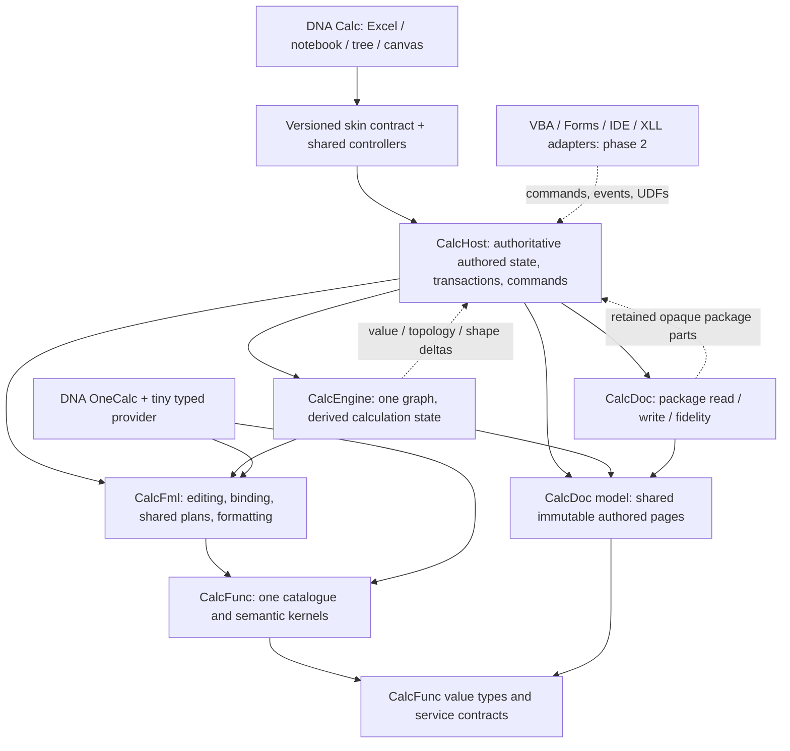

# DNA Calc re-implementation: architecture and executable core plan

**Status:** proposed implementation plan, not an implementation-completion claim.  
**Basis:** the uploaded planning prompt, draft v0.6, and the source samples recorded in §1.  
**Scheduling:** dependency order only. No dates, effort estimates, performance targets or calendar commitments.  
**Main execution artifacts:** the complete readable bead graph in §13 and `beads.plan.jsonl`. `beads.br.jsonl` is its native-schema export; `br-id-map.json` maps provisional IDs to import IDs.  
**Revision 2026-10-12 (owner-side review):** source availability corrected (OxDoc, the 2026-09-10 investigation and `consumer.rs` all exist in the local checkout); CalcDoc disposition firmed to restructure; the bundle scripts made UTF-8 safe on Windows; the native export imported with br 0.1.34 (252 records, no cycles, identical round trip). The bead edits and the roll-out sequence are in `ROLLOUT_BRIEF.md`.

## Executive decision

Build a **Rust monorepo with one Excel calculation model, one formula evaluator, one command/operation route and one verdict/capture system**. Carry the function implementations after provenance review; restructure the formula library around public shared plans; rewrite the dependency engine and authoritative application host. Restructure CalcDoc: its source is in the local checkout (verified 2026-10-12) and already carries preservation, typed refusals and first authoring, but it has not been audited line by line, so the source-pin task resolves exact symbols before any port.

Use caller-owned mutable state with immutable shared pages and plans—not whole-workbook immutable copies per edit. CalcHost owns authored workbook state; CalcEngine owns only calculation indexes, plans, dependencies, effects and results. Commit authored edits and engine input changes together. Recalculation is a separate, cancellable publication transaction.

Keep Leptos, Tauri and a Canvas2D grid, but replace the host/projection architecture. Desktop calculation runs in a native host; browser calculation runs in a dedicated wasm worker. Ship notebook, tree and canvas work in parallel with the basic grid. Store ordinary computations in **visible ordinary worksheet cells**, stable block locators in internal defined names, and non-semantic layouts in embedded CustomXML. Named functions remain actual Excel defined-name LAMBDAs, not a second formula language.

Make **Fast the default everywhere**. It uses pinned portable binary64 arithmetic/math policies. Offer **Exact only on explicitly validated native x86-64 numerical targets initially**. Do not claim that software extended precision alone recreates x87 transcendental behaviour. “Exact” identifies the requested Excel-target algorithm policy; its evidence badge still reports known divergences and unverified functions. The bit-exact campaign is continuous and does not hold up ordinary engine development.

The core graph is complete at the granularity described below. Charting/drawings, pivots, printing, external-data/analytical integrations and the remaining desktop command surface receive their core attachment work now and one detailed-planning bead each. **Those areas remain first-version release requirements.** Finishing their planning beads is not finishing their implementations.

---

## 1. Evidence, limits and decisions

### 1.1 What was actually checked

The uploaded brief explicitly requires code to outrank old documentation. This review read selected implementation ranges; it did **not** build the old repositories, run Excel, retrieve untracked caches, or audit every line. Retrieved default-branch files are not asserted to form a mutually buildable commit set. Source pinning and a compile audition are early tasks, not presumed facts. The owner-side review of 2026-10-12 confirmed every cited port path in the local checkout and recorded repository HEADs and uncommitted changes (`source-audit.json`); it also did not build anything or run Excel.

| Finding | Evidence read | Consequence |
|---|---|---|
| There really is a second formula evaluator in OxCalc. | `OxCalc/src/oxcalc-core/src/grid/machine/r1c1_plan.rs`: actual scalar/repeated-region evaluation and IF/IFERROR implementations. | Delete this evaluator. Port useful witnesses and sharing requirements to CalcFml, not its execution code. |
| Excel reference binding/provider machinery is hosted in the engine repository. | `OxCalc/src/oxcalc-core/src/grid/reference_engine.rs`: `StrictExcelGridReferenceProfile`, `ExcelGridReferenceSystemProvider`, per-sheet and cross-sheet value maps. | Move Excel binding/transforms into CalcFml; engine supplies typed lookup/data services. |
| The formula evaluator has private compiled forms and frame-local callable caches. | `OxFml/crates/oxfml_core/src/eval/mod.rs`: `compile_formula_for_evaluation`, `CallableRegistry`, `get_or_compile_body`, frame-local `Rc`/`RefCell`. | Public compilation and caller-owned frame/cache APIs are necessary. The brief’s exact per-evaluation compile claim was not independently traced through `EvaluationContext::new`. |
| The sampled value model defaults to Arc, while sampled OxFml constructs Rc-backed callable handles. | Both crate manifests; `Shared<T>` in value types; `CallableRegistry::register` in OxFml. | A likely cross-repository migration mismatch—not a reproduced build failure. Pin the revisions and compile before choosing reusable code. |
| Old host ownership is fundamentally different. | `DnaTreeCalc/.../workbook.rs`: `WorkbookSession` wraps `OxCalcDocumentContext` plus source-package state and tree/workspace addressing. | Rewrite orchestration and authority. Renaming this wrapper would preserve the wrong ownership. |
| The dependency taxonomy has useful distinctions. | `invalidation.rs`: value/visibility axes, spill anchors/blockers, name identity, sheet spans. | Reuse distinctions and witnesses; use new integer identities and one graph. |
| The sheet stage contains reusable rendering architecture. | `dnacalc-stage-sheet/src/lib.rs`: Leptos/Canvas2D imports, pure RenderPlan/geometry, DOM editor wiring. | Carry geometry/render-plan ideas, not assumptions that all gestures or virtualization already work. Add actual visual tests as well as receipt/geometry tests. |
| Numeric provenance is unresolved. | `x87.rs` explicitly identifies an NT source-tree implementation and contains native x87 assembly. | Quarantine that module and transitively derived material until reviewed. Removing a citation does not establish clean-room provenance. |
| OxDoc exists locally and already authors. | `OxDoc/crates/oxdoc-model/src/lib.rs` (5,939 lines, 191 `OxCalc*` symbols) and `OxDoc/crates/oxdoc-xlsx/src/lib.rs` (37,648 lines: preservation ledger, `RoundTripRefusal`, `WriteMode::FreshExport`, W010 tranche-2 cell/formula/sheet authoring landed 2026-09-15). The authoring run could not fetch them. | Restructure, not fresh slices: split the two monoliths, strip the engine-named types, port preservation/refusal/authoring behaviour after `infra-m0.4` pins exact symbols. The brief's statement that OxDoc cannot author yet is out of date. |
| The 2026-09-10 investigation exists locally. | `Foundation/notes/PROGRAM_INVESTIGATION_2026-09-10.md` (57 KB): the FileCached false-green trap, escalation accounting, the corpus census (Appendix B) and the diagnosis that the brief's lessons restate. | Its lessons are already brief §6. Its dual-profile direction (W5b) is superseded by the Excel-only decision of 2026-10-05. Its Appendix B census is the corpus baseline for `infra-m7.1`. |

The precise sampled paths and blob hashes are in `source-audit.json`. For example, the second evaluator is blob `f22100cb79bb262803df6e82e28e19734b9892a5`; the numeric provenance concern is blob `7a8aba4e30a35da3ba4505ca469408a81ac4d617`. A blob hash identifies inspected content, not a coherent multi-repository build.

The brief’s line counts, 527-row parity breakdown, 174-workbook corpus, 3.4 GB untracked evidence and historical performance figures are **owner-reported baseline facts, not measurements repeated in this review**. Preserve them as investigation inputs; regenerate current counts in the new evidence system. The 2026-10-12 review confirmed the parity ledger has 528 lines including its header and that the untracked evidence holds 1,618 cache files and 26,774 run files; the byte size was not re-measured.

### 1.2 Answers to all ten open questions

| Question | Decision | Alternatives considered and rejected |
|---|---|---|
| Language/runtime | Rust for product libraries, controllers and shared UI. A narrowly isolated .NET COM worker is acceptable Windows-only oracle tooling. | A C# engine complicates browser/native sharing and discards reusable Rust semantics; a JavaScript engine creates a second numeric/runtime implementation; an all-C++ rewrite gains little here. |
| Repository layout | One Cargo workspace/monorepo, one lockfile, explicitly layered internal crates, one coordinated change for interface migrations. Independent target directories per worker/job. | Separate repos with path dependencies preserve the demonstrated coordination hazard. A single gigantic crate removes useful dependency enforcement. |
| UI stack | Retain Leptos + Tauri + Canvas2D, with shared headless controllers, accessible DOM support and capability-aware adapters. | React/TypeScript would add another state/type boundary without removing engine risks. A new native UI framework would increase browser and four-skin rewrite work. Reassess only through a concrete failing interaction/accessibility experiment, not aesthetic preference. |
| Migration | Carry Func kernels conditionally; restructure Fml and Doc; rewrite Engine/Host; selectively reuse skin geometry/editor pieces; rebuild application integration. | Mechanical renaming retains ownership and duplicate-evaluator defects. Throwing away all kernels/tests forfeits the strongest existing assets. |
| Stateless | Explicit caller-owned state handles, immutable shared payloads, prepared change journals and generation-bound results. | Full-state cloning gives poor edit costs. Hidden singletons undermine multiple sessions and reproducible effects. Persistent data everywhere is unnecessary when one host owns mutation. |
| Skin persistence | Visible cell-backed hybrid, hidden internal locator names, optional user aliases, embedded layout manifest. | Names-only lacks an ordinary visible worksheet representation and makes relative/name semantics central to every block. A cell list without durable locators is fragile under real-Excel structural edits. The prior hidden append-only sheet is not adopted as the default. |
| Oracle infrastructure | One capture session implementation, one canonical observation format, one verdict library; preserve the smart-fuzzer acquisition lineage and convert old data through read-only importers. | Keeping four active capturers perpetuates inconsistent settings and verdicts. Introducing a new capturer while keeping all four active would be a fifth lineage, not consolidation. |
| Corpus | Generated/owner-cleared public core corpus plus provenance-reviewed external candidates; separately label private/non-redistributable material. | “Publicly downloadable” is not a license. Enron/EUSES/FUSE are candidates, not pre-approved permissive datasets. |
| Numeric modes | Portable deterministic Fast by contract and tested target matrix; native-target Exact initially; explicit unavailable result elsewhere; software-Exact feasibility measured separately. | Unqualified software80 “Exact” confuses precision with algorithm compatibility. Platform libm makes a cross-platform Fast contract harder to maintain. Silent fallback changes semantics without consent. |
| Separable areas | Charting/drawings, pivots, printing, external-data/analytical integrations, extended desktop command surface. See §9. | Notebook/tree/canvas are never separable/deferred. Core names, tables, iterative calc, TABLE, CF/DV and everyday dialogs cannot be pushed into a later area to make the core appear complete. |

The official Leptos and Tauri documentation supports the proposed shared web UI/desktop shell direction; the decision to keep them is architectural judgment, not a claim that their default components implement Excel. Microsoft’s recalculation documentation is one behavioural input, with actual version-specific observations retained beside it. SoftFloat is a useful extended-arithmetic comparison candidate, not evidence of Excel transcendental equivalence. [E1–E4]

### 1.3 Repository and dependency gates

Use `crates/{calc-value,calc-func,calc-fml,calc-doc-model,calc-doc,calc-engine,calc-host}`, `apps/{dna-onecalc,dna-calc}`, `ui/`, `platform/`, `tools/`, `corpus/` and per-package acceptance manifests. `calc-value` belongs to the CalcFunc library family; `calc-doc-model` belongs to CalcDoc. They are internal packaging boundaries, not new owner-level products.

Do not import old workset/ceremony/formal directories into the active tree. Keep immutable source provenance and valuable test data in a migration manifest. Use beads for execution. The single logical function catalogue is generated from per-family declaration fragments with stable IDs, so parallel ports do not edit one dispatch file. Source files and per-package manifests have one owning lane; agents do not all append to one global test registry.

Architecture gates inspect resolved Cargo metadata for every shipped target/feature combination, not just textual dependency declarations. Enforce:

- CalcFunc cannot depend on CalcFml, CalcEngine or CalcHost. Formatting is supplied through a lower-level service contract.
- CalcFml cannot depend on CalcEngine/Host/Doc codec. No tree syntax, profile IDs or alternative semantic evaluator.
- CalcEngine may depend on CalcDoc’s neutral model/input-view types, never its ZIP/XML codec, application or skins.
- Skins depend on the skin contract/controller layer, never engine internals.
- OneCalc’s **transitive** dependency closure contains no CalcEngine or CalcHost, including through UI helpers or features.
- Native COM/XLL/desktop filesystem implementations do not enter portable library/browser builds. Phase-2 adapter implementations remain absent.

The bootstrap is a checkpoint, not a substitute for the first functional milestone. Four lanes can start after it: Func catalogue/coercions, Fml parser/binder, Doc package/model, and Engine storage/graph. Their local manifests avoid shared-file contention.

## 2. Architecture, data flow and public contracts

### 2.1 Dependency and ownership diagram



Solid arrows mean dependencies/calls; dashed arrows show publication or future attachment. There is no arrow from OneCalc to Engine. The browser worker and native desktop process use these same public interfaces, not differently implemented engines.

### 2.2 API design principles

The following are **Rust interface sketches**, not compiled files. Referenced types are defined in their owning crates by the corresponding beads. Signatures fix ownership and data flow; avoid stabilizing incidental field layouts before the thin slice proves them.

```rust
// calc-value: compact identities; checked coordinate construction.
pub struct WorkbookId(pub u64);
pub struct SheetId(pub u64);
pub struct NameId(pub u64);
pub struct NodeId(pub u64);
pub struct CellKey { pub sheet: SheetId, pub row: u32, pub col: u32 }
pub enum NumericMode { Fast, Exact(NumericTargetId) }
pub struct SemanticContext {
    pub numeric: NumericMode,
    pub compatibility: CompatibilityKey,
    pub date_system: DateSystem,
    pub locale: LocaleKey,
}

// calc-func: generated registry metadata, explicit services and scratch.
pub fn resolve(registry: &RegistrySnapshot, id: FunctionId)
    -> Result<ResolvedCall, ResolveError>;
pub fn invoke(
    call: &ResolvedCall,
    args: &mut dyn PreparedArguments,
    services: &mut FunctionServices<'_>,
    scratch: &mut FunctionScratch,
) -> Result<FunctionResult, FunctionFault>;
pub fn prepare_registry_mutation(
    registry: &RegistryState, mutation: RegistryMutation,
) -> Result<PreparedRegistryChange, RegistryError>;
```

`FunctionServices` contains typed reference access, caller information, callable invocation, number-text service, time/random/external/RTD providers and explicit numeric policy. An eager/lazy argument interface follows catalogue metadata; kernels do not reach into workbook state. `FunctionFault` is infrastructure/admission failure, distinct from a successfully computed worksheet error value. Built-in catalogue tables are generated immutable data. Mutable UDF registries belong to the caller, not a global singleton.

```rust
// calc-fml: semantic compilation is not performed by evaluate().
pub fn edit(source: &mut EditState, change: TextEdit)
    -> EditResponse;
pub fn intern_template(
    source: FormulaSource<'_>, caller: FormulaAnchor,
    syntax: &mut SyntaxStore,
) -> Result<TemplateId, Diagnostics>;
pub fn compile(
    template: TemplateId, bindings: &dyn ReferenceCatalog,
    context: &CompileContext, cache: &mut PlanStore,
) -> Result<PlanHandle, Diagnostics>;
pub fn instantiate(plan: PlanHandle, caller: FormulaAnchor)
    -> Result<FormulaInstance, PlacementError>;
pub fn evaluate(
    instance: &FormulaInstance,
    services: &mut EvaluationServices<'_>,
    frame: &mut EvalFrame,
) -> EvalStep;
pub fn transform_references(
    formula: FormulaId, edit: &StructuralEdit,
    catalog: &dyn ReferenceCatalog,
) -> Result<FormulaPatch, TransformError>;
pub fn format_value(value: &CalcValue, format: &FormatPlan,
    context: &FormatContext) -> Result<FormattedValue, FormatError>;
```

`EvalStep` can complete, request a not-yet-ready dependency, yield or fail. An explicit resumable frame prevents browser stack-size dependence and allows cancellation without introducing hidden evaluator state. Plans and immutable callable bodies are `Arc`-owned and `Send + Sync`; a mutable evaluation frame is exclusively owned. No `Rc`/`RefCell` escapes a public boundary.

```rust
// calc-doc-model: the one versioned operation vocabulary.
pub enum WorkbookOp {
    SetCell { at: CellKey, input: CellInput },
    Clear { area: Area, fields: ClearFields },
    Fill { source: Area, target: Area, policy: FillPolicy },
    MoveCells { source: Area, target: CellKey, policy: MovePolicy },
    EditAxis(AxisEdit), EditSheet(SheetEdit),
    EditName(NameEdit), EditTable(TableEdit),
    EditRule(RuleEdit), EditStyle(StyleEdit),
    EditObject(ObjectEdit), EditSettings(SettingsEdit),
    EditSkinLayout(SkinLayoutEdit),
}
pub enum SessionOp {
    Workbook(WorkbookOp), Recalculate(RecalcRequest),
    Registry(RegistryMutation), External(ExternalUpdate),
    Refresh(RefreshRequest),
}
pub struct OpBatch {
    pub base: AuthoredRevision,
    pub source: CommandSource,
    pub operations: Vec<SessionOp>,
}

// calc-engine: computation state is supplied, not hidden in a service object.
pub fn prepare_edit(
    state: &EngineState, inputs: &CalcInputView,
    change: &ResolvedEditBatch,
) -> Result<PreparedEngineChange, PrepareError>;
pub fn begin_recalc(
    state: &EngineState, request: RecalcRequest,
    context: &CalcContext, effects: EffectTape,
) -> Result<RecalcWork, StartError>;
pub fn step(
    state: &EngineState, inputs: &CalcInputView,
    work: &mut RecalcWork, budget: WorkBudget,
) -> RecalcProgress;
pub fn finish(work: RecalcWork)
    -> Result<PreparedPublication, RecalcFailure>;

pub enum ValueProvenance {
    Calculated { tick: CalcTick, inputs: AuthoredRevision,
                 context: ContextFingerprint },
    FileCached { source: SourceHash },
    Stale { last_calculated: Option<CalcTick>, cause: StaleCause },
    NotModeled { feature: FeatureId, diagnostic: DiagnosticId },
}
pub struct RecalcFacts {
    pub evaluated: Vec<NodeId>,
    pub rescheduled: Vec<RescheduleFact>,
    pub escalations: Vec<EscalationFact>,
    pub value_deltas: Vec<ValueDelta>,
    pub shape_deltas: Vec<ShapeDelta>,
    pub topology_deltas: Vec<TopologyDelta>,
}
```

The operation vocabulary is logically one stream. Packaging separates authored-document operations from calculation/session envelopes; it does not grant a second editable workbook to the engine. Registry/external events participate in ordered session revisions even when no cell was authored.

```rust
// calc-doc: caller owns document and source; codec knows no engine.
pub fn open(source: &mut dyn PackageRead, policy: &OpenPolicy)
    -> Result<OpenedDocument, OpenError>;
pub fn prepare_edit(model: &DocumentModel, batch: &ResolvedEditBatch)
    -> Result<PreparedDocumentChange, EditError>;
pub fn prepare_save(
    snapshot: &DocumentSnapshot, values: &dyn SaveValueView,
    policy: &SavePolicy,
) -> Result<SavePlan, SaveRefusal>;
pub fn write(plan: SavePlan, out: &mut dyn PackageWrite)
    -> Result<SaveReceipt, WriteError>;

// calc-host: all callers, including future automation, use the same route.
pub fn dispatch(host: &mut HostState, command: HostCommand)
    -> Result<CommandReceipt, CommandError>;
pub fn step(host: &mut HostState, budget: WorkBudget)
    -> HostProgress;
pub fn subscribe(host: &mut HostState, request: InterestRequest)
    -> Result<SubscriptionId, ProjectionError>;
pub fn project(host: &HostState, request: ProjectionRequest)
    -> Result<ProjectionPage, ProjectionError>;
pub fn save(host: &HostState, request: SaveRequest)
    -> Result<HostSaveWork, SaveRefusal>;
```

A `ProjectionPage` is versioned, bounded and capability-oriented. It includes authored source, displayed/evaluated value, provenance, diagnostics, ranges/objects and view metadata as requested. It is neither a whole-sheet dump nor a tree-shaped universal workbook model. A receipt identifies committed revision, operation effects, pending calculation, undo group and fidelity/capability warnings.

### 2.3 Open → edit → recalc → save

**Open:** CalcDoc validates package boundaries, retains original parts and lazily parses necessary model pages. CalcHost adopts the model and provenance ledger. CalcEngine receives the same immutable input-page handles plus calculation-relevant metadata and builds one graph. File formula caches enter as `FileCached`, never as evidence that a formula was evaluated. Automatic/open settings initiate actual calculation; manual settings preserve a visible stale/file-cache state.

**Edit:** a named command resolves to a version-checked batch. CalcFml supplies input parsing and reference transformation. CalcDoc and CalcEngine prepare their effects against the same base revision. The host commits both prepared changes under its single mutation owner, then emits an authored delta and schedules permitted calculation.

**Recalc:** Engine evaluates affected participants through CalcFml, which invokes CalcFunc. Reads, effect use, shape and topology changes are staged with values. A completed generation is atomically published. Host subscriptions receive only relevant deltas. A UI skin cannot install its own cached answer as an engine result.

**Save:** the host pins an authored revision and matching result/provenance view. CalcDoc prepares a fidelity-checked save; untouched members are copied under the preservation policy, edited members are serialized. The save receipt clears dirty state only if the current authored revision still equals the saved one. Real Excel reopening and recalculating the output is an independent validation step, not an inference from the writer’s own ledger.

## 3. State, transactions and cost model

### 3.1 Exact ownership

| Owner | Holds | Does not hold |
|---|---|---|
| CalcDoc model, owned by CalcHost | Sparse authored cells/formulas; sheet/order metadata; names/tables/styles/rules/objects; document settings; relationships/opaque payload references; source fidelity/provenance. | A live dependency graph or an engine-specific cell/session type. |
| CalcHost | The authoritative model root; source package; operation journal and undo groups; lifecycle/trust/capabilities; skin layout/interests; calculation state handles and publication coordinator. | A second expression interpreter or a copied sheet of engine values for every UI refresh. |
| CalcEngine | Interned graph identities; structural and observed-read indexes; plan instances; dirty/SCC scheduling state; result/shape tables; effect ticks; calculated-object state. | An independently editable clone of all authored cells, source XML or skin layout. |
| CalcFml/CalcFunc | Caller-owned plan/syntax stores, frames, registries and explicit service bundles. | Hidden session globals or authority over workbook mutation. |
| Skin | Selection, viewport and in-progress text/gesture state; bounded subscribed projections. | Authoritative cell values, hidden dependencies or an independent undo history for workbook edits. |

### 3.2 Storage that does not duplicate a 100 MB workbook

Keep the original compressed package once, with member offsets/hashes and bounded decompression caches. Parse authored cell/style/name data into sparse, immutable pages once; Engine input views share those pages rather than ingesting copied strings and values. Computed results are a separate allocation only where they are genuinely additional data. Large text/array payloads use interned/Arc-owned storage.

A document edit copies or journals **only touched bounded pages and affected index nodes**. Do not use `Arc::make_mut` on a map whose single allocation contains the entire sheet; that still copies the sheet when a snapshot exists. Page boundaries and the allocation/read instrumentation are part of the implementation contract.

Use stable sparse cell identities and implicit axis intervals/order maps. Only materialized cells/participants need individual IDs. Row/column insertion splits/remaps axis intervals and transforms affected references; it must not allocate every coordinate or scan unrelated sheets. Order-sensitive formulas still observe current positions. Large genuine operations—fill a million cells, change a workbook-wide setting, save a changed sheet—may do proportionate work; an unrelated single-cell edit may not disguise such work as a default path.

The 100 MB workload records compressed input, retained package bytes, parsed authored bytes, graph, result and peak transient allocations separately. A compressed 100 MB workbook is not assumed to require only 100 MB of RAM. The requirement is avoiding needless copies, not a fabricated memory multiplier target.

### 3.3 Atomic edits, failure and publication

Use prepare/reserve/commit under a **single host mutation owner**. Prepared document and engine patches share the base revision, resolved IDs and structural transforms. Validate permissions, syntax, bounds, resource admission and necessary allocations before commit. Reserve undo data. The final paired commit performs no external calls and no expected fallible allocations; publish its receipt only after both revisions advance.

Do not claim arbitrary panic/OOM/process failure has been rolled back by an in-memory `Result`. A poisoned session stops publishing; the recovery path replays the last committed authored journal and reconstructs derived engine state with a counted recovery reason. A commit marker and saved checkpoints identify what was durable. This is different from quietly rebuilding the engine after every edit.

Recalculation is **not part of the authored edit’s all-or-nothing transaction**. If a recalc is cancelled, hits an infrastructure fault or cannot complete a required dependency, preserve the accepted edit and the engine’s matching input revision. Discard partial publication and label the previous affected results stale. An ordinary computed `#DIV/0!`, `#REF!` or other worksheet error is a valid calculated result, not infrastructure failure.

A generation commit includes values, spill reservations, read footprints and derived-object facts. No observer sees new values with old dependency edges or a new spill shape with old ownership. A newer edit invalidates in-flight work by revision; the initial engine can cancel and restart affected work, but records that action rather than silently committing old results.

### 3.4 Undo, redo and save refusal

Undo/redo stores inverse authored patches, formula transformations, object/layout changes and transaction grouping. Editor-buffer undo remains local until formula entry commits. Undoing a fill/paste is one command-level group. Macro/batch mode later uses the same journal with explicit grouping; it does not bypass validation.

Old calculated values do not automatically become fresh when an old authored revision is restored: the numeric target, registry, time/external epochs and relevant settings may have changed. Recalculate or validate the complete context fingerprint before reusing a result snapshot.

A refused save changes neither authoritative data nor engine input state and does not clear dirty state. Native saving writes a temporary file and installs it only after successful completion; browser saving produces a complete versioned blob/stream and records the platform’s actual acknowledgement semantics. Never promise a browser download was durably stored merely because bytes were generated. If the user edits during a save, the receipt identifies the saved revision and the newer document stays dirty.

### 3.5 Threading now and later

Each workbook host mutation/calculation lane is serial now. Desktop adapters run it away from the UI thread; the browser uses a dedicated worker and bounded resumable steps, so cancellation and commands can be processed. No dependency on browser shared-memory threads is required.

Immutable values/plans/input snapshots are designed for transfer or concurrent read. Later independent formula tasks may use separate frames against one snapshot; commits validate read/effect versions and arbitrate shapes through the same publication contract. Keep the single-thread strategy as a permanent executable oracle. Do not prebuild a second parallel graph/evaluator in this phase merely to reserve that option.

## 4. CalcFml: one language, one shared-plan API

### 4.1 Sharing is an API property, not an engine fast path

Split reusable syntax/semantic data from placement and execution:

`source → lossless tokens/CST → R1C1 template → bound plan → caller instance → evaluation frame`.

A `TemplateId` represents canonical token/AST structure, relative/absolute reference flags and literal identity. A `PlanKey` adds only the binding assumptions that actually matter: compatibility/grammar version, scope/name/table bindings, registry generation and any numeric/locale policy used during constant folding. A `FormulaInstance` supplies caller location and placement-sensitive bindings. A recalc tick or unrelated workbook edit is **not** a universal plan-cache invalidation key.

Two formulas can share syntax but require different bound plans where sheet-local names shadow workbook names. Relative defined names are instantiated in the appropriate caller context, not memoized as one global value. Structured references preserve row-context dependence. Absolute references remain absolute when caller position changes.

For fill-down, compile one source template and create instances directly. For individually authored/imported formula strings, scan/tokenize each source as necessary, normalize reference tokens with the real lexer and compare canonical identities before reusing a parsed template. Do not claim reading 100,000 strings is free. Do require that identical normalized templates do not cause 100,000 semantic parses/binds/compiles. Retain original source spelling via source spans/overrides or original package parts; do not retain 100,000 redundant full CSTs solely to preserve spelling.

Cache tests inspect actual shared allocations/handles and compiler calls, not a counter assigned by the caching code alone. The 100,000-formula fixture must exercise distinct caller positions, absolute/mixed references and scope-sensitive counterexamples. Subsequent evaluation must compile zero unchanged plans. A local name/table edit invalidates exactly plans that depend on its binding facts; constant-folded numerical plans are keyed by mode/target and must not survive an incompatible mode switch.

### 4.2 Typed Excel reference services

Move Excel reference grammar, binding, rendering and structural transforms out of OxCalc. The library understands A1/R1C1, unions/intersections/ranges, whole axes, sheet qualifiers/spans, structured references, spill `#`, implicit intersection and external workbook references. This is one Excel language, with Excel context roles—not an extensible tree-reference profile.

Separate **catalogue lookup** from **value access**. A catalogue resolves workbook/sheet/name/table identities and binding facts. A reader supplies values, shapes, visibility, existence and source readiness through typed range/cell requests. OneCalc implements a small fixture-backed catalogue/reader. It can evaluate `Sheet2!A1`, names, ranges or LAMBDA examples without owning a recalc engine; an unresolved fixture input is explicitly missing, not fabricated.

Range access is chunked/streamed and preserves blank cardinality. A whole-column SUM may skip physical blank storage, while COUNTBLANK or an array-producing function still sees the logical extent and appropriate blanks. Do not turn a whole-column reference into a million `CalcValue` objects unless the actual formula requires a million-element result. Memory/resource rejection is typed and counted, not an invented 100,000-cell semantic cap.

References also produce dependency facts: value, existence, shape, visibility, formatting/host metadata, name binding or structural order. CELL/INFO-style context reads and precision-as-displayed must observe relevant format/identity changes even when numerical inputs do not change. The engine does not reverse-engineer dependencies from rendered address strings. Structural reference transforms operate on bound/syntax records, including references in currently unexecuted branches; dynamic observed reads are a separate layer.

### 4.3 Evaluation, laziness and callables

The catalogue declares argument demand, reference preservation, coercion, array lifting, callable slots, volatility and context dependencies once. CalcFml implements the execution machinery for those declarations. Do not assume all functions listed under “lazy forms” have identical short-circuit behaviour. In particular, capture version-specific IFS/CHOOSE/SWITCH/IFERROR/LET/LAMBDA and array-context behaviour before assigning demand metadata. An unselected error, volatile expression or recursive call is a useful distinguishing witness.

Use an explicit evaluation stack/frame rather than native stack-growth helpers. Store reusable compiled bodies outside individual invocation frames. Lexically captured LET/LAMBDA values and free workbook-name references are different: immutable lexical captures travel with the closure; workbook references resolve with the correct defining/calling scope and live dependency identity. Do not serialize a process-local callable pointer.

A raw callable result is not automatically a legal displayed worksheet cell value. Preserve Excel’s uninvoked-LAMBDA cell outcome, while allowing OneCalc and a function inspector to show the raw callable as an explicitly different inspection surface. Named-function blocks use ordinary Excel defined-name LAMBDAs. Only an explicit invocation creates an evaluated worksheet result.

### 4.4 Number formats and number-to-text policy

CalcFml owns the formatting engine: format compilation, sections/conditions, numeric/scientific/fraction/percentage/accounting/date/time/elapsed/text handling, locale rendering and editor previews. CalcFunc owns the worksheet semantics and metadata of TEXT and related functions, but calls an injected lower-level `NumberTextService` implemented by CalcFml. This avoids a Func→Fml dependency and avoids two format engines.

Define separate purposes in that service: worksheet TEXT/concatenation/coercion, General display, localized input, invariant formula literals and document numeric serialization. Sharing policy does **not** mean these purposes produce identical strings. File numbers use invariant round-trippable encoding; localized display uses the workbook/session format context. Tests cover value-dependent rounding, thresholds, negative zero, date-system edges and precision-as-displayed effects with retained Excel observations.

Format compilation has its own caller-owned cache keyed by format text/ID and relevant locale/compatibility facts. CF style selection is performed by Engine rule participants; rendering a selected number format is CalcFml’s job. UI preview, formula TEXT and saved numerical values must not independently invent rounding policies.

## 5. Exact and Fast numeric policy

### 5.1 Scope and defaults

A numeric preference belongs to the **workbook’s CalcHost metadata**, with a separate equivalent OneCalc session preference. A calculation request may supply an explicit temporary override; its effective context is recorded in every result fingerprint and exported evidence. No implicit process-global mode exists.

New DNA Calc workbooks, OneCalc sessions and browser sessions default to **Fast**. This gives the same initial policy everywhere and avoids presenting an unverified collection of kernels as universally bit-exact. The UI exposes Exact as a deliberate target selection with availability and evidence status. Opening a workbook saved with Exact on an unsupported target presents a choice before recalculation: select available Fast, remain uncalculated with labelled caches, or move to an available Exact environment. It does not silently change the request.

Persist the mode and target identifier inside versioned CalcHost CustomXML metadata. Excel ignores this DNA-specific setting; ordinary formulas remain ordinary Excel formulas. On a later DNA reopen, actual file caches still have file-origin provenance until calculation under the selected DNA context occurs. Changing the effective mode triggers a full recalculation, including mode-sensitive folded plans and all derived formula participants. View-only formatting caches may be retained only where their fingerprint remains valid.

### 5.2 Availability and the x87 issue

Initially Exact is available only through a provenance-cleared, validated **native x86-64 backend/target pair**. Windows and Linux can execute that adapter where the architecture supports it; support is established by the retained target matrix, not by the operating-system name. Browser wasm and ARM do not acquire Exact merely because a portable arithmetic library offers an extended-precision type.

The inspected x87 source itself claims dependence on particular transcendental instruction results. Its commentary and local witness count are not universal proof. Software80 arithmetic can reproduce precision and rounding for basic operations without reproducing every approximation or instruction result used by a specific Excel/CPU target. The software feasibility tasks explicitly separate arithmetic agreement, transcendental algorithm identification and held-out end-to-end Excel parity. [E2]

Quarantine unresolved NT-derived code, constants and generated descendants. Retain clean black-box observations with acquisition provenance. A replacement native wrapper must be justified through public ISA behaviour and independently derived arithmetic graphs; no disassembly or leaked-source consultation is allowed. Its floating-point environment handling must be explicit and restore the caller’s state. Clearing the wrapper’s provenance does not automatically clear every numeric helper it calls.

`NumericTargetId` identifies Excel build/channel/compatibility and observed numerical environment, with CPU-family evidence where relevant. Use one **selected reference target** for a campaign. Do not silently change targets between machines and call differing results both exact. A target matrix disagreement produces a new target/evidence distinction.

### 5.3 Declare differences once

Generate mode routing and metadata from one catalogue:

- mode-independent functions/operators use one implementation;
- mode-sensitive entries declare their numeric substrate or resolved backend hooks;
- context-sensitive conversions, comparisons, formatting thresholds and reductions also declare dependencies where witnesses show differences;
- function evidence is independently `verified-on-corpus`, `divergent`, `unverified` or unavailable for the selected target.

Sensitivity propagates through helper/backend dependencies rather than hundreds of handwritten `if exact` branches. A formula result can be calculated in Exact-target mode while its function family still has known mismatches. The report must say both. An Exact mode label is not permission to overwrite that evidence with a blanket correctness claim.

### 5.4 Fast determinism and scoring

Choose cross-platform deterministic Fast as the product contract. Pin the portable math implementation, literal parsing/number-text policy and compiler/feature configuration. Avoid platform libm/JavaScript Math substitutions and uncontrolled reassociation/FMA changes. Native adapters control required floating-point environment details. Windows/Linux/browser replay uses identical effect tapes and input bits. A library upgrade must rerun this matrix before the determinism claim carries forward.

This has development and sometimes runtime cost; record it instead of setting a speed target. Fast is a simpler arithmetic policy, not a promise that every function is faster for every input. Browser/native correctness measurements determine whether a selected portable library actually meets the contract.

Exact scoring compares raw observed Excel values bitwise for numbers, with independently defined handling of worksheet-visible representations and error types. Fast is compared with Exact-target observations using declared per-function, domain-qualified absolute/relative/ULP policies. No global epsilon. Text, booleans, error identities and array shapes still require semantic equality. A tiny numeric error that changes a branch, lookup, convergence decision or shape is a **semantic divergence**, not automatically a tolerance pass.

Random/time/external witnesses record an effect protocol. Replaying captured effects proves formula behaviour **conditional on those effects**, not that DNA’s random generator is identical to Excel’s undocumented generator. Report stochastic/effect-dependent evidence separately.

## 6. CalcEngine: the single-threaded reference implementation

### 6.1 One calculation domain

Use one graph across all sheets of a workbook. Open workbooks with live cross-workbook links can join a host-owned calculation domain keyed by WorkbookId/SheetId; they must not be joined by repeated per-sheet value-copy rounds. Closed external books are versioned snapshot-provider boundaries with declared freshness and trust policy. The ordinary one-workbook case remains simple; multi-workbook cycle handling uses the same SCC machinery.

Allocate node IDs for actual formulas, named-formula instances and other participants, not for every cell of the address space. Use interned identifiers and checked integer coordinates at boundaries. Keep structural references and observed reads as two indexes over **one graph**, not two calculation engines.

A deterministic ready queue with maintained prerequisite counts replaces quadratic ready-list scans. SCC condensation handles cycles; schedules remain dependency-valid above 10,000 formulas. The initial strategy may conservatively reschedule affected nodes when dynamic edges change, but reports the reason and never drops topological constraints to meet a size threshold.

### 6.2 Participant model

| Participant | Graph representation and invalidation | Calculation/publication |
|---|---|---|
| Formula cell | Node plus compiled-plan instance; typed scalar/range/name prerequisites. | Evaluate through CalcFml; publish value/error and actual reads. |
| Literal/blank cell | Sparse input/existence address or interval fact, with IDs allocated only when needed. | Input changes seed dependents; blanks are not materialized as billions of nodes. |
| Ranges, whole rows/columns | Compressed interval/rectangle edges; value, membership and visibility facets. | Chunked readers preserve logical shape/blanks; actual array results may allocate proportionately. |
| Workbook/sheet names | Scope-aware identity and binding-version nodes; formula instances where caller-dependent. | Evaluate static/dynamic/ref-returning names in the correct context; unresolved names remain watched identities. |
| 3D sheet spans | Endpoint identities plus current ordered sheet membership. | Resolve through current sheet order; sheet lifecycle edits invalidate membership and transformed references. |
| Structured tables | Table/column identity, extent/header/totals/row-context facets. | Shared formula plans instantiate against table context; table edits update membership without string matching. |
| Spills | Anchor node, owned result extent and blocker/existence watches. | Stage shape and reservation with values; blocker edits retry anchors; `#SPILL!` is calculated, not preserved cache. |
| Volatile/effect calls | Tick/effect epoch and call-site identities. | Recalculate under command policy and recorded effects; external updates are not conflated with volatility. |
| INDIRECT/OFFSET/dynamic refs | Static input dependencies plus replaceable observed reference/read footprint. | Resolve with CalcFml; require fresh prerequisites, reschedule when necessary, install reads with result atomically. |
| What-if TABLE | Dedicated table participant, input override specification and output extent. | Run ordered scenarios through the same graph/evaluator using transient overrides; restore base inputs, publish table output as derived values. |
| Conditional formatting | Rule/template/applicability nodes plus aggregate/visibility dependencies. | Compute formula/style decisions for requested targets and materialized interests, using compressed applicability; rules can invalidate when their inputs change. |
| Data validation | Rule/template/source dependencies plus candidate-context evaluation. | Evaluate actual allowed values/constraints/messages through CalcFml; candidate validation occurs before committing relevant edits. |
| Chart series | Derived-object identity, source plans/ranges, visibility/settings and dataset revision. | Core calculates source dependencies and exposes versioned dataset access; charting area renders and edits charts. |
| Pivot/GETPIVOTDATA | Source/cache/layout/refresh identities plus output ownership. | Core exposes refresh transactions and invalidation; pivot area implements cache aggregation/layout and queries. GETPIVOTDATA uses that real service, not cached literals disguised as execution. |
| External links/RTD | Provider/source identities, explicit snapshot/update epochs and unavailable/stale states. | Queued updates become operations; live linked books share the calculation domain where appropriate. |

Readiness is part of the provider contract. A formula reading a dirty unevaluated prerequisite receives a scheduling request, not an old value silently treated as current. Missing targets create absence/existence watches so later creation invalidates the correct formulas.

Chart and pivot **attachment** completion is not chart rendering or pivot refresh completion. Their separate feature metrics remain incomplete until implementations arrive. Pivot refresh policy is distinct from ordinary recalc: source changes can mark a pivot refresh-needed without pretending a refresh already occurred. Formula calculation coverage and derived-object refresh coverage are reported separately.

### 6.3 Recalculation semantics and settings

Support automatic, manual and automatic-except-data-tables policies. Implement F9, Shift+F9, full recalculation and dependency-rebuild commands as distinct named requests, with app-wide/active-sheet scope represented explicitly. Capture order, dirty-state and cross-sheet behaviour rather than assuming that the keyboard label alone fixes all semantics. Microsoft’s documentation confirms that data tables and iteration have special calculation behaviour, including table cycles that are not ordinary forbidden circular references. [E1]

Carry both date systems, compatibility settings, `calcPr`, recalculation-on-open and precision-as-displayed. The latter is not merely a display option: capture its calculation/persistence effects and route any required authored numerical changes through the shared operation machinery. Never implement it as UI text rounding only.

For iterative calculation, identify SCCs, determine observed initialization/update order and apply maximum-iteration/change criteria with the selected numeric policy. Record convergence, non-convergence, errors and actual iterations. Test coupled cells, cross-sheet and open-cross-book cycles, dynamic reference changes, and interaction with arrays. Do not substitute a canned result table. Unsupported handling is acceptable during development as honest diagnostics but **fails the mandatory first-version feature exit**.

Data tables use a base input snapshot with temporary row/column input overlays. Reuse the same evaluator/graph services; do not create another TABLE-only interpreter or permanently write scenario inputs into the workbook. Preserve order-sensitive/effect behaviour according to captured cases. One- and two-variable tables, table-related cycles, automatic-except-tables and interrupted calculation have separate acceptance cases.

### 6.4 CF and DV are not display-only features

CF applicability may cover a whole column without a million allocated rule instances. Store the applicable regions and shared plans; materialize target evaluations for interests, explicit queries and output operations, tracking their dependencies. Rules needing region-wide statistics have explicit aggregate participants. Precedence, `stopIfTrue`, differential formats, color scales, bars and icon sets produce typed facts consumed by the renderer.

DV supplies actual candidate-context evaluation, formula-driven lists, error/warning/input policies and source dependencies. A UI edit, paste and programmatic operation can have different observed enforcement rules; the command source/context is explicit and the captured policy decides. “Always reject every invalid value” is not assumed to be Excel-compatible. Filtering/hiding can affect functions/rules that observe visibility; include that dependency facet.

A rule-related edit may invalidate rule decisions without changing ordinary cell values. Deltas must carry that change. A successful rule evaluation is evidenced by actual CalcFml calls and observed effects, not by an enum saying `Supported`.

### 6.5 Publication, escalation and the reference twin

Return changed values, shape ownership, topology updates, evaluated IDs and typed escalation facts. Distinguish requested full recalculation from conservative broadening, dynamic rescheduling, graph recovery and unsupported admission. Every unexpected broadening has a stable reason and a named replacement-owner/bead. The counters are cross-checked against independently instrumented evaluator/provider traffic.

The permanent reference strategy is the product’s initial engine. Later optimized strategies must consume the same operations, explicit effects and semantic evaluator. Differential comparison includes dependencies, shapes, provenance and completion—not just final numbers. A missed dynamic edge that happens not to affect the first answer must still be detectable. The initial twin harness tests this using deliberately faulty test strategies; it does not install a second shipping engine lane.

## 7. CalcDoc: representation, preservation and authoring

### 7.1 Migration status and module boundaries

OxDoc's source is in the local checkout: `oxdoc-model` (one 5,939-line file), `oxdoc-xlsx` (one 37,648-line file) and a 10,934-line conformance crate. “Restructure” is the decision; it is still not a statement that the implementation has passed audit. `infra-m0.4` pins the exact reader/writer/model/refusal/authoring symbols before any port, and OxDoc's uncommitted cell-add authoring work must be committed before pinning.

Split the package layer, relationships/content types, workbook/sheet model, cell/shared-string codec, styles/formats, names/tables, CF/DV, objects, external/rich-data metadata, preservation ledger and authoring writer. A single very large `lib.rs` is not a module boundary. Keep the public facade cohesive while implementations and tests have separate owners.

The neutral model stores cells/formulas, shared strings, styles and number formats, defined names, tables, CF/DV, comments/notes/hyperlinks, drawings/charts, pivot definitions/caches, external links, richData/`cm`/`vm`, `calcChain`, custom XML and opaque VBA payloads. Chart/pivot-specific deep codecs can be completed by their separable-area task graphs using the core attachment types. They remain required for first-version document coverage.

### 7.2 Fidelity is checked, not merely asserted

Retain original package members, ordering/relationship metadata and hashes. Copy untouched members byte-for-byte under the chosen ZIP preservation policy, including raw compressed payloads where possible. A modified ZIP central directory or package does not imply the entire archive remains byte-identical. Independently check each unchanged member’s content and, where promised, compressed representation.

For edited parts, preserve unknown attributes/elements when safe and maintain relationships, content types and dependent parts coherently. A structural edit can invalidate an unknown part’s references even when that part’s bytes are untouched; preserving those bytes blindly is not fidelity. Preflight known dependency effects and emit typed save refusals or explicit fidelity risk when preservation cannot be justified. Do not quietly drop data to make a file open.

Do not freeze the old count of “62 refusal kinds” as a design goal. Retain useful refusal distinctions after source review, add new ones when genuinely required, and report each encountered category. Core required authoring scenarios must pass; they cannot be declared complete because a refusal enum exists.

### 7.3 Authoring is part of the first slice

The thin slice already adds a formula and writes a repair-free file. Subsequent beads support cell/formula removal, range fills, shifted/axis edits, sheet lifecycle, names/tables/styles/rules, fresh documents and Save As. Writer tests use independent package inspection and actual Excel reopen/recalc, not a reader and writer that can agree on the same mistake.

Shared and array formulas need correct authored/template metadata; dynamic-array caches/metadata and legacy array extents are not interchangeable. Preserve unsupported future extensions without turning their cached output into a calculated pass. Newly written formula text is standard Excel text, with the appropriate serialized compatibility conventions.

Formula caches are supplied through a provenance-aware `SaveValueView`. Write fresh calculated caches only for the matching authored/context revision. For stale/unmodeled results, follow an explicit omit/preserve-file-cache policy and set applicable recalc-on-open metadata; do not relabel an old `<v>` as a new calculated answer. Imported pivot/output cells require derived-object ownership so an object refresh does not overwrite user-authored cells or claim cached object data is refreshed.

`vbaProject.bin` is preserved but not executed. Saving modified signed content must not imply the signature remains valid. Refuse, preserve unchanged or explicitly strip/re-sign only under an admitted user policy; signing/VBA execution is not silently implemented here. ZIP/XML resource limits, external relationships and active content are security boundaries from the first loader, including browser loading.

## 8. CalcHost, four skins and phase-2 seams

### 8.1 Capability-oriented skin contract

Use `CommandId` plus typed command-family payloads, not one enormous tree-first intent enum. Families cover document lifecycle, cell/range editing, references/names/tables, rules, formatting, objects, calculation, diagnostics, views and recovery. A versioned capability descriptor identifies which operations and projections are available and why an unavailable operation is unavailable.

Every ribbon item, shortcut, menu, gesture and dialog confirmation invokes a named command. The controller resolves it into the canonical operation stream. Headless `calcctl` and future automation invoke the same controller. Projection requests name interests: worksheet windows, block IDs, dependency neighborhoods, object data or diagnostics. Responses carry a base/current revision and typed deltas. Detect revision gaps and refresh only affected subscriptions.

There are four distinct state classes: authoritative workbook data; calculated values/facts; durable per-skin layout; ephemeral selection/editor/gesture state. Treating them separately prevents a viewport move from triggering recalc or a temporary text buffer from entering the undo journal as a committed formula.

### 8.2 Persistence alternatives

| Design | Where computation lives | Where order/prose/tree/positions/view state live | Merits | Failure modes |
|---|---|---|---|---|
| A. Every block is a defined name | Names contain constants/formulas; a visible result sheet would be an additional projection. | Embedded manifest for layout and rich prose; ordinary cells required for useful visible Excel presentation. | Natural named functions and aliases; name identity is explicit. | Ordinary Excel use becomes Name-Manager-centric; relative-name context affects every block; spill presentation needs real anchors; adding a visible result sheet effectively becomes a hybrid. |
| B. Structured cell list in a normal/hidden sheet | Ordinary formula/value cells; optional labels and aliases. | Prose in cells, richer layout in manifest or reserved columns. | Straightforward Excel interoperability; actual grid/spill behaviour; modest metadata. | Bare row numbers/addresses are fragile after insert/delete/move; deleting the storage sheet destroys data; hidden storage is less meaningful to an Excel-only user. |
| C. Cell-backed hybrid — selected | Ordinary cells for calculations; names as durable internal locators and optional user aliases; actual defined-name LAMBDAs for function blocks. | Prose is visible cell content; markdown/layout annotations and per-view placement are embedded metadata. | Visible Excel workbook remains useful; Excel can adjust locator references on structural edits; one computational authority with several layouts. | Internal-name/manifest overhead; user deletion/rename and metadata stripping need explicit reconciliation; function blocks need a clear distinction between definition and invocation. |

Choose C, but **do not copy the earlier hidden append-only `_names` design wholesale**. For a new notebook/tree/canvas-origin workbook, create an ordinary visible, descriptively named backing worksheet with labels/prose and calculation anchors. For an existing workbook, a block may link directly to an existing cell/range: do not copy its value/formula onto a new backing sheet just to display it differently.

Each semantic block has a stable UUID and one anchor/defined-name identity. A hidden internal locator name refers to the physical anchor, with a versioned manifest recording the block ID and locator. Optional user-friendly aliases are separate names. Per-view placements have their own IDs, so the same block can appear in different notebook orders, tree locations or canvas positions without changing its computational identity.

The manifest contains schema version, block-to-locator mapping, block kinds, view order, prose presentation/markdown annotations, tree parent/child relationships, canvas world coordinates/z-order and per-view state. It contains **no authoritative calculated answers**. Visible prose/cell contents remain authoritative where represented in the sheet. Markdown is inert/sanitized presentation, not executable workbook code. No sidecar file is needed.

### 8.3 The required interchange cases

| Case | Names-only | Cell-list only | Selected hybrid behaviour |
|---|---|---|---|
| Same workbook in two skins | Shared names, separate layouts; visible worksheet experience requires extra cells. | Shared anchors, separate layouts; simple until anchors move. | Both subscribe to the same authored IDs/results; layouts are independent; one edit/undo stream. |
| Excel inserts rows, renames names or deletes a backing sheet | Renames can invalidate manifest identity; no universal visible storage rule. | Insert/delete can stale stored numeric row addresses; deleting storage destroys it. | Resolve internal locator references first; reconcile renamed locators only with unique evidence; explicit orphan/ambiguous diagnostics on deletion. Never resurrect cached formulas/values from the manifest. |
| Names refer to other blocks | Natural, but scope/relative evaluation must be correct. | Works through optional aliases or ordinary cell refs. | User aliases resolve to actual anchors; relative defined names retain caller semantics; renaming is one host operation. |
| LAMBDA-valued blocks | Natural defined-name functions, but not ordinary cell-display semantics. | A raw `=LAMBDA(...)` cell is not silently a displayed callable result. | Raw formula cells retain Excel outcomes. An explicit function block owns an actual named LAMBDA; Name Manager edits are authoritative; examples invoke that name in cells. |
| Spills | Requires real worksheet result anchors to show arrays usefully. | Native grid anchors and blockers; neighboring list records can conflict. | Keep genuine anchor/child ownership and `#SPILL!`; provide explicit reserve-space/physical-move commands, never automatic invisible rearrangement. |
| 10,000 blocks | Name lookup/metadata and useful display overhead must be measured. | Compact; structural identity recovery remains weak. | Measure hidden-locator/manifest/package overhead; shared plans and windowed projections; no assertion of speed without data. |

Actual cross-skin and real-Excel modification fixtures prove these behaviours. `infra-m2.1` covers the earliest scalar/cell-backed slice; `infra-m3.3` completes all advanced cases. Comparison serializers are test tooling, not three shipping workbook models.

If Excel strips the manifest, retain the ordinary grid and names, offer a diagnosed flattened view and allow the user to rebuild layouts. If it deletes an internal backing sheet, show orphaned blocks without inventing replacement contents. If it renames or removes a locator, use unique surviving anchors/name content and manifest evidence to propose recovery; never guess silently where several cells qualify. A broken explicit alias becomes normal Excel reference/name error semantics.

A named-LAMBDA function block has **one executable definition: the defined name**. A displayed source string or documentation cell is a labelled projection, not another editable executable body. The skin edits the name via the name command; real Excel edits it through Name Manager. A grid invocation example supplies a normal calculated result. This avoids violating the “one authoritative workbook” rule in the persistence layer itself.

### 8.4 First-version notebook skin

A notebook is an ordered view of prose blocks, linked cell/range blocks, formula blocks and explicit named-function blocks. It is **not** a sequential interpreter. Run-cell and run-all commands request dependency calculation with visible manual/automatic policy, not Python-like hidden execution order.

Provide insert/delete/reorder, split/join prose where representable, markdown editing, formula completion/signature help, result/error/provenance display, collapsible virtualized arrays, function definition/invocation inspection and keyboard traversal. A result shows its actual workbook anchor. Formula edits and named-function edits go through CalcHost. Reordering notebook blocks is view-only; moving physical cells is a separate reference-transforming command with an undo group.

A dependency panel navigates to actual cells/names and can open the same source in the grid, tree or canvas. Spill blockers identify the physical grid cells causing the conflict. Add explicit reserve-space tools once structural operations land. A 10,000-block notebook renders a bounded window and can navigate distant blocks without creating 10,000 DOM editors.

### 8.5 First-version tree editor

The tree represents hierarchy for organizing linked workbook blocks. Parent/child relationships are view metadata, **not lexical scope, a reference system or implicit aggregation**. A child formula uses the same Excel names/references as in the grid. Dragging/reparenting changes organization only unless the user invokes an explicit workbook command.

Provide expand/collapse, keyboard parent/child/sibling navigation, insert/delete/reparent, editable labels/prose, formula/value columns, errors/spill summaries, function blocks and dependency navigation. Distinguish hierarchy edges visually and semantically from dependency edges; a dependency cycle is not a tree-parent cycle. Prevent malformed parent cycles in layout metadata without altering formula semantics. Multiple placements of one block remain views of one anchor, not independent cells.

### 8.6 First-version calculation canvas

The canvas contains movable/resizable calculation cards, prose, linked ranges and function cards, with durable world coordinates, z-order, grouping and pan/zoom. Cards expose actual formulas/values/errors/provenance and expandable spill results. Connectors can show dependencies without creating them.

A deliberate “connect as reference” gesture invokes formula editing or a specified named command, producing a standard Excel reference at a chosen argument/insertion point. Do not make every decorative line a hidden equation. Show the resulting formula before committing ambiguous edits. Moving or resizing cards changes layout only; physical worksheet moves remain explicit operations.

Provide keyboard selection/navigation, text entry, range picking, multi-card layout grouping, dependency highlighting and cross-skin “show source” actions. Use virtualized visible card/range projections; the underlying workbook remains fully Excel-addressable.

### 8.7 Excel skin and OneCalc

The Excel skin is not the only design client of the host. Its early work is grid/formula bar/core editing; later core beads cover the command families in §9. Shared detailed editors and diagnostics are reusable by the other skins, but do not force those skins into row/column-centric navigation.

OneCalc has its own small application controller and fixture provider. It exposes editing, all admitted functions/operators, references, arrays/LAMBDAs, formatting, mode/evidence status and traces with no dependency engine. It stores formula-session fixtures, not a concealed CalcHost workbook. Its catalogue/help/example explorer is generated from CalcFunc metadata. Native and browser **shipped-package** dependency tests enforce this boundary.

### 8.8 Phase-2 attachments with real phase-1 callers

| Future capability | Phase-1 home and contract | Actual phase-1 traffic | Beads |
|---|---|---|---|
| Source-neutral UDF registration/unregistration/invalidation | Caller-owned CalcFunc registry; CalcFml resolved-call generations and plan invalidation; Host registration command. | Named-function/extension registry administration through `calcctl` and function tools; unregister invalidates actual callers. | `cfunc-m4.1`, `cfml-m4.3`, `chost-m4.12` |
| Volatility/thread safety/async/caller context | Function metadata and explicit evaluation services; async ticket generation and cancellation. | Effect providers, dynamic registry examples and actual external-update replay. | `cfunc-m4.1`, `cfml-m4.3`, `ceng-m4.6` |
| Application/Workbook/Worksheet/Range dispatch | Late-bound Host dispatch over canonical queries/commands; no engine object exposed. | Headless command/object inspector and automation route used by integration tools. | `chost-m4.12` |
| Events and exclusive macro transactions | Post-commit event queue, source/context records, exclusive serial transaction mode. | Existing batch import/multi-command edits, change/calculate subscriptions and replay. | `chost-m4.11`, `chost-m8.1` |
| External/RTD updates | Explicit versioned session operations, not volatile mark-all. | Refresh/replay/update controls issue actual operations with stale-completion rejection. | `ceng-m4.6`, `chost-m4.10`, `chost-m4.11` |
| Excel12v-facing callbacks | Typed Host service/query/command protocol with capability and caller restrictions; later adapter owns XLOPER12 marshalling. | Formula/context queries and named command invocation through the public service route. | `chost-m4.13` |
| RefEdit/range picking | Range-selection session with commit/cancel and stable document identity. | Formula, CF/DV and other range-picking dialogs. | `chost-m4.13`, `dnacalc-m6.22` |
| Embedded IDE/forms panels | Dock/panel service, focus and lifecycle contracts. | Diagnostics/watch/formula panels, not an empty test-only panel registry. | `chost-m4.13`, `dnacalc-m6.19`, `dnacalc-m6.22` |

No VBA compiler integration, COM automation implementation, XLL loader/marshaller, forms runtime or IDE is built now. The source-owned callback restrictions must distinguish worksheet evaluation from commands/macros; a future callback cannot bypass the host transaction owner. Queued external events during an exclusive transaction have explicit ordering after its commit.

A mechanical call-site manifest is necessary but insufficient: integration tests must execute actual non-test application/CLI callers and inspect their effects. An unused enum variant plus a unit test is not a completed seam.

## 9. Excel UI inventory and separable areas

### 9.1 Full inventory policy

The following is the initial **complete inventory of the brief’s named command families**, plus reserved broader areas. It is not asserted to exhaust every command in an unpinned Excel desktop release. `infra-m3.1` pins the actual reference edition/build, captures the full surface and reconciles every additional command into this matrix. Newly discovered phase-1 commands must receive a core or separable-area owner; they cannot disappear behind a “not in the original list” rule.

Each command ledger row stores a stable command ID, ribbon/menu/shortcut/dialog routes, headless operation, target/context/platform, status (`not-started`, `partial`, `done`) and **executed test evidence**. The initial plan does not mark proposed commands done. A disabled button is not implementation. Native OS/browser restrictions are separately recorded, with explicit alternate invocation where possible; do not claim an intercepted browser shortcut is identical to native Excel.

| Family | Required surface | Core beads or later area owner |
|---|---|---|
| Chrome | Ribbon tabs/groups/contextual tabs, File/backstage, QAT, key tips | `dnacalc-m6.1`; additional inventory in `infra-m3.24` |
| Formula entry | Name box, multiline formula bar, tooltips/completion, F2/F4, enter/edit/point, IME | `cfml-m6.2`, `dnacalc-m6.3`, `.11` |
| Selection | Cell/range/multi-area/axis selection, Ctrl/Shift extension | `dnacalc-m6.2` |
| Fill | Fill handle, AutoFill series/options, formula reference adjustment | `chost-m4.2`, `dnacalc-m6.4` |
| Drag | Move/copy/insert gestures, conflict/cancel policy | `dnacalc-m6.5` |
| Clipboard | Text/HTML/internal payload, documented native formats, Paste Special | `chost-m4.2`, `dnacalc-m6.6` |
| Axes/panes | Freeze/split, heights/widths/auto-fit, hide/unhide, outlines/groups | `chost-m6.1`, `dnacalc-m6.7` |
| Cell formatting | Format Cells Number/Alignment/Font/Border/Fill/Protection; mixed states | `dnacalc-m6.8`, `.9` |
| Styles | Cell styles, themes, format painter, clearing | `dnacalc-m6.10` |
| Names | Name Manager, scope, refersto editing, navigation | `dnacalc-m6.11` |
| CF | Galleries, rule manager, priority, stop-if-true, applies-to | `chost-m5.2`, `dnacalc-m6.12` |
| DV | Settings/input/error tabs, lists, messages, candidate prompts | `chost-m5.3`, `dnacalc-m6.13` |
| Search/navigation | Find/Replace, Go To, Go To Special | `chost-m4.6`, `dnacalc-m6.14` |
| Sort/filter | Multi-key/custom sort, AutoFilter, advanced filter | `chost-m4.4`, `dnacalc-m6.15` |
| Tables | Create/resize/rename/convert, headers/totals/calculated columns, styles | `chost-m4.3`, `dnacalc-m6.16` |
| Structural editing | Insert/delete shifted cells/axes/sheets, move/copy/hide sheets | `chost-m4.1`, `.3`, `dnacalc-m6.17` |
| Calculation | Manual/automatic/except-tables, F9 variants, iteration, precision/date, Exact/Fast, Data Table | `chost-m4.8`, `chost-m5.1`, `dnacalc-m6.18` |
| Formula audit | Evaluate Formula, trace precedents/dependents, watch, error checking | `chost-m6.3`, `dnacalc-m6.19` |
| Review/links | Comments, notes, hyperlinks, sheet/workbook protection | `chost-m4.7`, `chost-m6.2`, `dnacalc-m6.20` |
| Status/windows | Selection aggregates, zoom, sheet tabs, window navigation | `dnacalc-m6.21` |
| Undo/redo | Text-local versus workbook groups, paste/fill/transaction granularity | `chost-m2.2`, `chost-m4.9`, `dnacalc-m6.3`, `.22` |
| Keyboard/accessibility | Context-sensitive shortcuts, focus order, semantic grid mirror | `dnacalc-m6.22`, `.24` |
| Charts/drawings | Insert/edit/format chart families and shapes/images; contextual UI | `infra-m3.20` |
| Pivot UI | Field list/layout, grouping/filtering/slicers, cache refresh, GETPIVOTDATA | `infra-m3.21` |
| Output | Page layout/setup, preview, printing and export surfaces | `infra-m3.22` |
| External/analytical | Get/transform/import/refresh, connections, linked/data-model features, Goal Seek/Solver inventory | `infra-m3.23` |
| Remaining desktop surface | Other captured commands/dialogs, custom/advanced/review/service entrypoints | `infra-m3.24` |
| Phase 2 reserved | Developer tab, VBA editor, Forms, add-ins manager | `chost-m4.13`, `dnacalc-m6.22`; explicitly not first-phase implementations |

Original or appropriately licensed icons, illustrations and fonts must have an asset manifest. Reproduce familiar command organization and behaviour without copying proprietary artwork or representing the application as Microsoft Excel. Visual acceptance includes real rendered pixels and accessibility trees, not only hidden render counters. Canvas geometry and a bounded DOM editor/accessibility projection coexist.

Use logical segmented scrolling/windowed interests for the full grid; do not depend on a single DOM element with the physical height of a million rows. Full-sheet selection is a range descriptor, not a cell enumeration. “Responsive at a million rows” is exercised through real input/cancellation/rendering tests and measured workloads, without inventing latency targets.

### 9.2 Separable area boundaries

**Charting and drawings — `infra-m3.20`.** Covers series binding/rendering, familiar line/area/column/bar/pie/doughnut/scatter/bubble/stock/radar/surface families, combinations/secondary axes, applicable 3D and modern statistical/hierarchy/waterfall/funnel/geographic families from the pinned inventory; chart formatting, titles/labels/legends, shapes/images, anchors, hit testing and accessibility. The detailed plan resolves exact family support and service-dependent cases; naming a family here is not implementation evidence. Excludes pivot aggregation and page pagination. Depends on the initial engine, CalcDoc object/relationship model and host dataset/command services. Core attachments: `ceng-m3.8`, `cdoc-m3.5`, `chost-m3.1/.2` and inventory. Risks: hidden-row/missing-data semantics, series names/array constants, font/layout demands, external data, chart-linked formulas and anchor transforms. The area graph must include required CalcDoc codecs and actual rendering tests, not just UI controls.

**Pivot tables — `infra-m3.21`.** Covers pivot cache records/schema, source ranges/tables/connections, aggregation, grouping, calculated fields/items where applicable, filters/slicers, layout/subtotals/grand totals, formatting, refresh policies, output-cell ownership and GETPIVOTDATA. Data-model/OLAP-specific providers coordinate with external integrations; no silent flat-table substitution. Depends on source identities, table/name/range semantics, transactional object output and refresh lifecycle. Core attachments: `ceng-m3.8`, `cdoc-m3.5`, `chost-m3.2`. Risks: refresh versus recalc distinction, source value/error coercion, stable field/item identity, output overlap and source-driven cycles. The planning bead follows initial engine/object attachment, not final UI completion. A first-version release requires actual refreshed pivots and working queries.

**Printing and page layout — `infra-m3.22`.** Covers page setup, margins, scale/fit, print areas/titles, repeated rows/columns, breaks, headers/footers, themes/fonts, chart/object inclusion, preview and platform output. Excludes formula semantics and chart implementation. Depends on shared format/measurement services, snapshot values, document page setup and bounded render/export APIs. Core attachments: `cdoc-m3.5`, `chost-m3.2` plus pane/dimension/style work as available. Risks: unit conversions, text wrapping, font substitution, printer capabilities, whole-sheet enumeration and browser print-dialog restrictions. Plan after initial document/host attachment; implement area-specific authoring/renderers through its generated graph.

**External data and analytical integrations — `infra-m3.23`.** Covers import/query/connection refresh, trust/credentials/cancellation, linked rich-data providers, CUBE/OLAP and data-model-backed sources, and the captured analytical/what-if UI beyond TABLE (including Goal Seek/Solver surfaces). Excludes core external workbook references, RTD operation plumbing and data tables, which are already core. Depends on external snapshot/provenance, registry/provider APIs, refresh transactions and table/object ownership. Core attachments: `ceng-m3.7/.8`, `cdoc-m3.4/.5`, `chost-m3.2`; async lifecycle expands in M4. Risks: service availability, credentials, streaming updates, cancellation, numerical solver policies and pivot-provider coupling. No undefined service integration is marked complete merely because a preserved connection part exists.

**Extended desktop commands/dialogs — `infra-m3.24`.** Covers remaining commands found in the pinned full inventory, including advanced customization, review/history/sharing/collaboration/service entrypoints and dialogs not assigned elsewhere. Explicitly excludes the listed core dialogs and all non-Excel skins. Depends on the captured inventory and real command/capability/document model. Core attachments: command registration slots, capabilities, events, objects and platform adapters. Risks: discovering a feature whose state was not represented, service-backed behaviour, conflicting browser shortcuts and accidental command duplication. Its output must classify every captured row and create executable implementation tasks. It cannot close by displaying disabled copies of the remaining ribbon.

For all five, the planning bead belongs after the initial engine/host attachment exists. It generates a validated implementation graph, identifies any core changes discovered, and adds mandatory implementation exits to the release gate. This deliberately defers **detailed area planning**, not feature delivery or required core attachment work.

## 10. Testing, oracle evidence and measurements

### 10.1 One verdict path with independent populations

Use a portable verdict library consumed by unit/corpus/live-capture tools and the product conformance command. Inputs include case/source hashes, authored operations, calculation context, effect tape, independently enumerated formula coordinates, observed values/types/shapes and result provenance. Numeric raw observations are stored as hex binary64 bits plus typed nonnumeric values, not lossy JSON decimal round-trips.

The first headline is **calculated formula coordinates / authored formula coordinates**. Then report matched/calculated, with mismatch, unsupported, stale/file-cache, failed and not-run populations. Independently reconstruct shared-formula/legacy-array formula coverage from file metadata. Keep dynamic-spill children and names/rules/chart/pivot participants as separate output/participant populations rather than quietly mixing them into the formula-cell denominator. One array-anchor evaluation can legitimately calculate many declared outputs; record both actual evaluator calls and covered coordinates.

An engine-produced status flag cannot establish that evaluation occurred. Reconcile provenance against instrumented calls, read/effect observations and revision-bound publication. Fault-injection tests deliberately supply a perfect cached answer without evaluating it: the report must still count zero calculated passes for that formula.

`<v>` observations are useful for offline workbook comparison, but not automatically proof of fresh raw Excel binary results. Keep `ExcelRawObservation`, `ExcelSavedCache` and unknown-freshness cache origins distinct. Capture raw `Value2` numeric bits with Excel build/settings/effect metadata for Exact certification. Saved cache text may be stale or insufficient evidence for a last-bit claim. The same verdict library handles both origins with different evidence strength; do not create another verdict implementation for live runs.

### 10.2 Capture consolidation and evidence storage

Select the **smart-fuzzer COM acquisition lineage** as the migration source for live capture, with exact runner files resolved by `infra-m0.4`. Consolidate its behaviour into one isolated Windows capture worker/session protocol; a typed .NET worker is acceptable tooling. OxReplay/OxXlPlay and older conformance bundles become **read-only format importers** where useful. Disable old active capture routes once the unified route is admitted. The reverse-direction XLL add-in is not an XLL-host implementation.

A capture manifest records original workbook/formula/operations, Excel edition/build/channel, compatibility, numeric environment/CPU, locale/date/calculation settings, raw values, error and array shape, input/output package hashes, capture-tool revision, trust settings and failures. Macro execution and automatic external refresh are disabled unless a specifically admitted scenario requires them. A missing Excel installation is `not-run`, never a replay masquerading as a live capture.

Before migration work risks the current caches, inventory and hash the owner-accessible untracked directories, store content-addressed blobs with versioned manifests and verify a second independent backup. Keep small minimized witnesses/manifests in git; use durable bulk artifact storage for large data. Store acquisition provenance separately from algorithm implementation provenance. Legacy data without a known Excel fingerprint remains useful investigation evidence, not certification for a newly selected target.

Neither review backed those directories up: they hold 1,618 cache files and 26,774 run files, untracked and not ignored. `infra-m0.6` performs and proves the backup/restore task; do it before any other work touches OxFunc.

### 10.3 Corpus policy and coverage floors

The public starter corpus is generated/owner-cleared and explicitly licensed. Add independent generator families rather than thousands of trivial filename variants. The expansion milestone requires at least **1,000 distinct workbooks, 200 multi-sheet workbooks and 50 workbooks combining three or more feature categories**, with exact strata/counts independently checked. These are proposed evidence-volume exit criteria, not current measurements or performance targets.

Cover axes/whole ranges, scope/relative names, table/3D references, external snapshots/live links, dynamic arrays and blockers, legacy arrays, recursive/named LAMBDAs, manual/automatic modes, dates/locales/precision, iterative SCCs, TABLE, CF/DV and structural edits. Include valid, invalid and boundary cases. Chart/pivot/print areas add their own independently captured families after detailed planning.

For Enron/EUSES/FUSE-class candidates, record original distribution source, collection and file-level rights, redistribution basis, privacy/trust constraints and duplicate hashes. A dataset’s research use or online availability does not establish permission to publish every workbook. Keep unapproved or non-redistributable inputs out of the public bundle. An admission report may truthfully conclude that no candidate qualifies; the generated core corpus still progresses. [E5]

### 10.4 Test layers and CI

| Layer | What it proves | Where it runs |
|---|---|---|
| Unit/semantic witness | Exact typed values/errors, coercion, parser/formatter/reference behaviour. | Windows, Linux, actual wasm browser tests. |
| Property/state-machine | Reference transformations, operation/undo invariants, sparse storage, package safety. | All portable targets; larger fuzz campaigns in native tooling with retained replay. |
| Engine/product integration | Host operation → Engine → CalcFml → CalcFunc → delta/save is the actual application route. | Native and browser controllers; installed/deployed app smoke tests. |
| Reference-twin differential | Future strategy cannot miss reads/shapes/provenance even when numbers initially match. | Portable deterministic replay; initially intentionally faulty test adapters. |
| Offline corpus differential | Calculation coverage and output agreement for independently enumerated file formula populations. | All three platforms against retained observations. |
| Live Excel capture | Version-scoped black-box behaviour and fresh raw expected results; repair-free reopen. | Isolated Windows tooling with Excel; resulting evidence replays elsewhere. |
| Round-trip/authoring | Unchanged-part preservation, relationship correctness and usable new/edited workbooks. | Portable package inspection plus live Excel reopen/recalc. |
| UI/visual/accessibility | Real gestures, focus, pixels and semantic accessibility tree—not merely model counters. | Browser bundles and Windows/Linux application adapters. |
| Architecture/traffic | Forbidden dependencies absent; public variants have real production callers and exercised effects. | CI Cargo metadata/source manifests and integration coverage. |
| Benchmarks | Recorded cost/allocation profiles with correctness evidence. | Native and actual browser paths; no pass/fail speed thresholds. |

From bootstrap, CI builds every portable library/application core for Windows/Linux/wasm and executes native plus real browser tests. A wasm compile-only job is not browser validation. Platform adapters have separate native jobs. Pin tools; every CI job and every agent checkout (a full clone on master, never a worktree or a branch) has its own target directory. Lanes integrate continuously by pulling and pushing master through the one lockfile instead of relying on mutually unpushed sibling repositories.

The acceptance runner fails when a required named test does not exist, runs zero cases, is silently skipped or lacks its declared platform evidence. It discovers per-package manifests, so adding tests does not create a central file bottleneck. Infrastructure bootstrap tasks use bootstrap-native commands until that runner exists; all later acceptance commands are introduced by `infra-m0.3`.

### 10.5 Continuous numeric campaigns and named workloads

A smart-fuzzer campaign captures, compares, minimizes, stores and reruns mismatches through the same observation/verdict path. Algorithm search may propose general arithmetic graphs from clean observations; shipping literal answer tables is prohibited. Keep held-out probes, recorded search context and counterexample provenance. A remaining last-bit mismatch is not a pass, but it does not block unrelated engine/skin work.

Named workloads cover cold/warm recalc, 20k chains, 100k shared formulas, single edits across sheets, whole columns, more than 100k materialized results, full-grid viewport navigation, 10k notebooks, a 100 MB workbook memory profile, SCCs, data tables, CF/DV and native/portable numeric backends. Record input sizes, actual evaluated participants, escalation counts, timings, allocations, peak memory, compiler/target/mode and correctness. No timing or memory target is assigned.

Structural assertions remain legitimate: no whole-sheet clone on an unrelated one-cell edit; no O(P²) ready-list; shared allocation identity for a repeated plan; no dense allocation merely to select an entire sheet. These are architecture constraints verified through independent instrumentation, not claims that a particular machine will meet an invented latency threshold.

## 11. Migration table and dependency-ordered milestones

### 11.1 Per-library disposition

| New library/app | Disposition | Carry/read from | Deliberately discard or replace |
|---|---|---|---|
| CalcFunc | **Carry kernels; restructure catalogue/numeric boundary.** | `OxFunc/.../function.rs`, `function_call.rs`, `registry.rs`, `functions/surface_dispatch.rs`; value types; admitted per-family implementations/tests resolved to exact paths in the source manifest. | Three handwritten dispatch paths; Rc opt-out at public boundaries; global mutable state; formal artifacts; unreviewed x87-derived code; stale parity claims. |
| CalcFml | **Restructure substantially.** | `syntax/`, `language_service/`, `binding/`, `semantics/`, `eval/mod.rs`, `format/`; private compiled forms; Excel reference parse/transform machinery from `OxCalc/.../reference_engine.rs`. | Tree/host-reference grammar and profiles; overlapping host/runtime/consumer/session/seam/publication/scheduler facades; per-evaluation compilation; per-frame-only plan sharing; stack-growth assumptions. |
| CalcEngine | **Rewrite.** | Dependency facets in `invalidation.rs`; spill ledger design/tests; effect tick/RNG lessons in `workbook_nodes.rs`; differential/escalation ideas; input snapshot IDs and workload catalogue. | `consumer.rs` ownership/god object; per-sheet federation; string-keyed identity; R1C1 side evaluator; caps/topological shortcuts; default full rebuilds; tree lane, TraceCalc and formal artifacts. |
| CalcDoc | **Restructure** (source verified locally 2026-10-12). | `oxdoc-model`, `oxdoc-xlsx` (preservation ledger, `RoundTripRefusal`, `FreshExport` Save As, W010 cell/formula/sheet authoring), `oxdoc-conformance`, `oxdoc-cli`; lazy-profile and typed-refusal concepts. | The 191 `OxCalc*` model names; the one-file codec monolith; the read-only writer assumption, which is out of date. Exact port symbols must be resolved first. |
| CalcHost | **Rewrite around decided authority.** | `DnaTreeCalc/.../workbook.rs`, `command.rs`, `defined_names.rs`, `grid_publication.rs` as behavioural references; skin-IR precedent. | Engine-owned authored state, tree workspace/address wrapper, full snapshot publication and missing workbook undo. |
| DNA OneCalc | **Rebuild lean application controller; reuse formula UX selectively.** | Formula UX and generated catalogue/help ideas; bench examples only after portability audit; architecture-gate idea. | Engine/host dependencies, legacy verification bundles that spawn cargo through machine-specific paths, duplicated formula providers/evaluators. |
| DNA Calc | **Rewrite integration; selectively reuse UI primitives.** | `dnacalc-shell/src/stage.rs`, sheet geometry/render-plan/editor pieces, notebook interactions and design tokens where independently verified. | Old `dnatreecalc-*` stack/16-skin sprawl, tree-first IR, no-op interest channels, debug-counter-only visual confidence. |
| Oracle/replay tooling | **Consolidate.** | Smart-fuzzer COM acquisition, provenance-first conformer concepts, old capture bundles through read-only converters. | Multiple active capture/verdict lineages and unversioned local-only ground truth. |

The per-family function tasks are **bounded port/admission work**, not promises that a single task resolves every numerical discrepancy in its family. They must enumerate exact copied files and retained witnesses. Semantic gaps get distinct follow-up campaign work and visible evidence; the catalogue cannot advertise an unimplemented function as calculated. Mandatory first-version core features have stronger actual-execution exits.

### 11.2 Milestones and observable exits

Milestone labels group related deliverables; they are not global phase barriers. A lane starts when its explicit dependencies are ready. In particular, non-Excel skins start in M2 alongside the basic grid; they do not wait for M6’s Excel UI.

| Milestone | Observable exit | Proving beads |
|---|---|---|
| M0 — bootstrap checkpoint | Portable skeleton and real target CI; forbidden dependency/zero-test gates work; separate lane clones build without shared target writes. Source/evidence safety tasks unblock only relevant ports. | `infra-m0.1/.2/.3`, `cfunc-m0.1`, `cdoc-m0.1` |
| **M1 — first functional milestone** | Open a real Excel-authored two-sheet workbook; calculate via product host; provenance-first compare, including a deliberately corrupted cache; edit a value and add a formula; save; actual Excel opens without repair and produces expected values. | `infra-m1.3` and its Func/Fml/Doc/Engine/Host/capture prerequisites |
| M2 — sharing and early four-skin product | 100k equivalent formulas share a plan; OneCalc has no Engine; notebook/tree/canvas/grid edit the same scalar/cell-reference workbook; 10k-block persistence and early real-Excel structural/recovery cases execute. | `cfml-m2.1/.2`, `ceng-m2.1`, `onecalc-m2.1`, `infra-m2.1` |
| M3 — unified workbook semantics and attachments | Names, 3D/table/dynamic references, arrays/spills/external snapshots work through one graph; advanced LAMBDA/spill skin interchange completes; derived-object attachments have traffic; separable planning can start. | `infra-m3.2/.3`, `ceng-m3.8/.9`, `chost-m3.2`, planning beads `.20`–`.24` |
| M4 — editing/settings/lifecycle | Structural edits, undo/redo and settings operate atomically; save/calc failures preserve matching revisions; every escalation is visible; phase-2-neutral services have production callers. | `infra-m4.1`, `ceng-m4.5/.6`, `chost-m4.10`–`.13`, `cfml-m4.3`, `cfunc-m4.1` |
| M5 — hard calculation features | Real SCC iteration, one-/two-variable TABLE, CF and DV pass independent captures and interaction cases, including cross-book cycle scenarios. No cached/typed-unsupported substitute counts as feature closure. | `infra-m5.3` plus `ceng-m5.1`–`.9`, `chost-m5.1`–`.3` |
| M6 — complete named core UI/document authoring | Every captured **core** command has real UI and headless tests; full core authoring/reopen matrix passes; all four skins consume advanced facts. Other phase-1 areas remain pending. | `infra-m6.1`, all M6 app/Host/Fml/Doc families |
| M7 — measured conformance | Corpus floors/strata reconcile; Exact/Fast/effect evidence is honestly classified; portable Fast target tests and retained named benchmarks run; known mismatches remain visible. | `infra-m7.10` and corpus/numeric/benchmark/fuzz dependencies |
| M8 — core integration | Shipped native/browser packages use the tested route; OneCalc closure remains engine-free; all core and phase-2 attachment evidence reconciles. | `infra-m8.1`, `dnacalc-m8.1`, `onecalc-m8.1` |
| **First-version release** | Core plus actual implementations/exits generated by every separable-area plan. No mandatory inventory row or chart/pivot/print implementation remains merely planned. | Fail-closed checker introduced by `infra-m8.2`, then the later generated area implementation exits |

Closing `infra-m8.2` means the **release checker exists**. Its first acceptance deliberately proves that an unimplemented chart/pivot/print area blocks release. The task’s closure is not a release-readiness boolean. This avoids a planning-bead dependency trap in which all existing tasks could be closed while the declared product is still missing major features.

## 12. Risks and early detection

| Risk | Detection and response | Earliest tasks |
|---|---|---|
| Source snapshots are not coherent: four legacy repositories (OxCalc, OxDoc, OxFml, DnaTreeCalc) had uncommitted changes at review time. | Commit or stash before pinning; hash/pin inputs; compile selected revisions; mark each module verified/provisional/unavailable. | `infra-m0.4` |
| Numeric implementation violates the clean-room rule. | Quarantine provenance and derived descendants; retain independently acquired witnesses; admit only reviewed sources. A suspicious citation is a reason to investigate, not proof of how code was produced. | `infra-m0.5`, `cfunc-m3.24` |
| “Exact everywhere” becomes a misleading claim. | Target fingerprint and availability checks; held-out CPU/backend matrix; ext80 and transcendental feasibility distinguished. | `cfunc-m3.22/.24`, `cfunc-m7.1`, `infra-m7.6` |
| Shared plans bind wrong caller/name context. | Same-template/different-anchor and local-name shadowing counterexamples; test handle sharing and actual results together. | `cfml-m2.1/.2`, `cfml-m3.1` |
| Host/Engine diverge after a failed edit/calc/save. | Failure injection at prepare/commit/publication/save boundaries; independently compare revisions and authored reads. | `chost-m1.1`, `infra-m4.1` |
| Sparse/persistent structures still clone huge maps. | Independent read/allocation instrumentation, page-sharing tests and 100 MB component memory accounting. | `cdoc-m4.1`, `infra-m7.8` |
| Browser engine blocks input or depends on native stacks. | Actual wasm worker cancellation/input tests; explicit evaluation frames; segmented grid scrolling. | `cfml-m1.3`, `dnacalc-m2.1/.5` |
| Skin persistence is another hidden workbook model. | Real-Excel edits/delete/metadata-strip matrix; no authoritative values in manifest; function definition has one owner. | `infra-m2.1`, `infra-m3.3` |
| Hard Excel semantics are guessed from broad docs. | Distinguishing captures before SCC/TABLE/CF/DV settings implementations; failures retained, not hard-coded. | `infra-m5.1/.2` |
| Corpus scores caches instead of calculations. | Inject matching cached answers with no evaluation; independently enumerate formula populations and audit actual calls. | `infra-m1.1`, `infra-m7.4` |
| Evidence disappears or cannot be reused legally. | Two verified backups; content-addressed manifests; license/privacy admission and restore tests. | `infra-m0.6`, `infra-m7.1/.3` |
| Future areas require core redesign. | Real dataset/refresh/page/command attachments now; area planning after initial engine; explicit late-discovery core changes become tracked blockers. | `ceng-m3.8`, `cdoc-m3.5`, `chost-m3.2`, `infra-m3.20`–`.24` |
| Full UI claims hide browser/service gaps. | Pinned inventory, per-platform capability/status ledger and alternate invocation tests; missing behaviour remains partial/not-started. | `infra-m3.1`, `dnacalc-m6.22/.24` |
| Tests exercise an easier path than the product. | Headless controller and shipped-package scenarios share library routes; visual/accessibility tests inspect actual output; no second evaluator. | `infra-m1.3`, `infra-m6.1`, `dnacalc-m8.1` |
| Scope completion becomes another self-assigned status. | Core/release distinction, independently reconciled coverage and fail-closed generated-area gate. | `infra-m8.1/.2` |

## 13. Complete bead graph and execution rules

The following outline is generated from the same records as the JSONL. Each task’s full description is in `beads.plan.jsonl`; every description contains Outcome, Context, Do, Port from, Acceptance, Platforms and Out of scope. The companion JSONL is not a shortened title-only backlog. All acceptance commands/tests are **implementation requirements for the new repository**, not claims that they currently exist in the legacy repositories or were executed while writing this plan.

Epics group work and contain no implementation work. A `parent-child` dependency associates a task with its epic; it is not a blocking wait for the epic to close. A `blocks` dependency listed on task X names a prerequisite that X waits for. Provisional IDs use the requested library prefixes. The native export preserves those IDs exactly. Current `br` documentation explicitly supports mixed prefixes in one project; its configured prefix is the default for newly created IDs, not a restriction on imported records. This was executed on 2026-10-12 with br 0.1.34: 252 records imported, no cycles, one ready task, and a flush-only re-export identical to the import. Use `dc` as the prefix for new issues; `calc` would collide with OxCalc's existing `calc-` bead IDs in handover notes. `br-id-map.json` is therefore an identity map. The native export adds the required Issue/Dependency timestamp and source fields without changing task identity. [E6]

The graph is a finite executable **core** plan, not a claim to have enumerated the future chart/pivot/print implementation graphs before their required discovery. The five area planning tasks create those graphs and attach their real implementation exits to release requirements. Any newly discovered core dependency is an explicit graph amendment, not an agent-local alternate implementation.

When an exact old implementation/test path could not be verified here, the task says so and names the source-manifest prerequisite. Agents must resolve its exact paths/symbols before porting; inaccessible code is not copied from memory. Most function-family tasks are mechanical family ports/admission with semantic tests, not unrestricted whole-library repair tasks.

See `coverage.json` for machine-readable mappings from milestones, UI families, numeric requirements, persistence cases and phase-2 seams to beads. `validation-report.json` describes the artifact checks actually run. It does **not** substitute for Rust compilation, Excel tests or an actual `br` import.

<!-- GENERATED_OUTLINE -->


**204 tasks · 48 epics · 252 total records.** Full descriptions and named acceptance cases are in `beads.plan.jsonl`.

An arrow `←` names blocking prerequisites. Epic membership is listed by the grouping and is not a blocking wait for epic closure.

### M0: Bootstrap checkpoint — independent lanes, CI and evidence safety

#### `infra-m0` — Infrastructure

- **`infra-m0.1`** Create the monorepo and isolated crate workspaces (P0) ← none
- **`infra-m0.2`** Install Windows Linux and browser CI (P0) ← `infra-m0.1`, `infra-m0.3`
- **`infra-m0.3`** Build the acceptance runner and architecture gates (P0) ← `infra-m0.1`
- **`infra-m0.4`** Pin legacy sources and resolve inaccessible migration inputs (P0) ← `infra-m0.1`
- **`infra-m0.5`** Quarantine questionable numeric provenance (P0) ← `infra-m0.4`
- **`infra-m0.6`** Back up and content-address existing oracle evidence (P0) ← `infra-m0.4`

#### `cfunc-m0` — CalcFunc

- **`cfunc-m0.1`** Define portable values IDs and numerical policy (P0) ← `infra-m0.1`, `infra-m0.4`

#### `cdoc-m0` — CalcDoc

- **`cdoc-m0.1`** Define engine-neutral authored operations and revisions (P0) ← `infra-m0.1`, `cfunc-m0.1`

### M1: First functional milestone — real Excel open/recalc/edit/save/reopen

#### `infra-m1` — Infrastructure

- **`infra-m1.1`** Unify cache and live-oracle verdicts (P0) ← `infra-m0.3`, `cfunc-m0.1`
- **`infra-m1.2`** Implement one isolated Excel COM capture adapter (P0) ← `infra-m1.1`, `infra-m0.4`
- **`infra-m1.3`** Prove the first real workbook round trip (P0) ← `chost-m1.2`, `infra-m1.2`

#### `cfunc-m1` — CalcFunc

- **`cfunc-m1.1`** Generate the initial function catalogue and call interface (P0) ← `cfunc-m0.1`, `infra-m0.3`
- **`cfunc-m1.2`** Port base coercions and scalar arithmetic (P0) ← `cfunc-m1.1`, `infra-m0.4`

#### `cfml-m1` — CalcFml

- **`cfml-m1.1`** Port the lossless Excel lexer and basic parser (P0) ← `infra-m0.1`, `infra-m0.3`, `infra-m0.4`, `cfunc-m0.1`
- **`cfml-m1.2`** Implement typed reference binding without the engine (P0) ← `cfml-m1.1`, `cfunc-m1.1`
- **`cfml-m1.3`** Expose reusable compiled plans and evaluation frames (P0) ← `cfml-m1.2`, `cfunc-m1.2`

#### `ceng-m1` — CalcEngine

- **`ceng-m1.1`** Create workbook-wide graph storage and literal input access (P0) ← `infra-m0.3`, `cfunc-m0.1`, `cdoc-m0.1`
- **`ceng-m1.2`** Calculate the thin slice through CalcFml (P0) ← `ceng-m1.1`, `cfml-m1.3`

#### `cdoc-m1` — CalcDoc

- **`cdoc-m1.1`** Implement bounded ZIP package reading and raw preservation (P0) ← `infra-m0.3`, `cdoc-m0.1`, `infra-m0.4`
- **`cdoc-m1.2`** Load scalar cells formulas and file-cache provenance (P0) ← `cdoc-m1.1`
- **`cdoc-m1.3`** Author cell changes and write a repair-free thin workbook (P0) ← `cdoc-m1.2`

#### `chost-m1` — CalcHost

- **`chost-m1.1`** Commit authored and engine edits as one transaction (P0) ← `cdoc-m1.3`, `ceng-m1.2`
- **`chost-m1.2`** Expose open recalc save and delta projections (P0) ← `chost-m1.1`

#### `onecalc-m1` — DNA OneCalc

- **`onecalc-m1.1`** Ship the engine-free OneCalc application controller (P0) ← `cfml-m1.3`, `infra-m0.3`

### M2: Shared formulas and all four skins over one workbook

#### `infra-m2` — Infrastructure

- **`infra-m2.1`** Prove cross-skin xlsx persistence with Excel edits (P0) ← `dnacalc-m2.6`, `chost-m2.4`, `infra-m1.2`

#### `cfml-m2` — CalcFml

- **`cfml-m2.1`** Canonicalize R1C1 templates and binding-context keys (P0) ← `cfml-m1.3`
- **`cfml-m2.2`** Invalidate reusable plans by semantic dependencies (P0) ← `cfml-m2.1`
- **`cfml-m2.3`** Compile LET LAMBDA closures and invocation (P0) ← `cfml-m2.1`, `cfunc-m1.1`
- **`cfml-m2.4`** Port metadata-driven lazy control forms (P0) ← `cfml-m2.3`
- **`cfml-m2.5`** Expose incremental editing and formula-language services (P0) ← `cfml-m2.1`
- **`cfml-m2.6`** Own number-format parsing and numeric text policy (P0) ← `cfml-m1.3`

#### `ceng-m2` — CalcEngine

- **`ceng-m2.1`** Instantiate shared formula regions without a second evaluator (P0) ← `ceng-m1.2`, `cfml-m2.2`

#### `cdoc-m2` — CalcDoc

- **`cdoc-m2.1`** Persist view manifests and stable locator names (P0) ← `cdoc-m1.3`

#### `chost-m2` — CalcHost

- **`chost-m2.1`** Define capability-organized skin intents and subscriptions (P0) ← `chost-m1.2`, `cdoc-m2.1`
- **`chost-m2.2`** Implement canonical commands and undo journal (P0) ← `chost-m2.1`
- **`chost-m2.3`** Implement block editing on ordinary worksheet anchors (P0) ← `chost-m2.2`
- **`chost-m2.4`** Reconcile non-Excel layouts after real Excel edits (P0) ← `chost-m2.3`

#### `onecalc-m2` — DNA OneCalc

- **`onecalc-m2.1`** Add OneCalc editing traces formats and callable fixtures (P0) ← `onecalc-m1.1`, `cfml-m2.3`, `cfml-m2.5`, `cfml-m2.6`

#### `dnacalc-m2` — DNA Calc

- **`dnacalc-m2.1`** Build shared shell and desktop/browser transport (P0) ← `chost-m2.1`, `infra-m0.2`
- **`dnacalc-m2.2`** Implement the notebook skin editor (P0) ← `dnacalc-m2.1`, `chost-m2.3`, `cfml-m2.5`
- **`dnacalc-m2.3`** Implement the tree editor skin (P0) ← `dnacalc-m2.1`, `chost-m2.3`, `cfml-m2.5`
- **`dnacalc-m2.4`** Implement the free-form canvas skin (P0) ← `dnacalc-m2.1`, `chost-m2.3`, `cfml-m2.5`
- **`dnacalc-m2.5`** Implement the Excel skin minimum grid and formula bar (P0) ← `dnacalc-m2.1`, `cfml-m2.5`
- **`dnacalc-m2.6`** Show formula details and dependency navigation in every skin (P0) ← `dnacalc-m2.2`, `dnacalc-m2.3`, `dnacalc-m2.4`, `dnacalc-m2.5`, `cfml-m2.3`

### M3: Workbook-wide references, arrays, names and extension attachment points

#### `infra-m3` — Infrastructure

- **`infra-m3.1`** Capture and reconcile the complete reference Excel UI inventory (P0) ← `infra-m1.2`, `chost-m2.2`
- **`infra-m3.2`** Prove the unified workbook engine milestone (P2) ← `ceng-m3.4`, `ceng-m3.5`, `ceng-m3.6`, `ceng-m3.7`, `cfml-m3.4`, `chost-m3.1`, `infra-m1.2`, `infra-m3.3`, `ceng-m3.9`
- **`infra-m3.3`** Complete the advanced skin persistence interchange matrix (P0) ← `infra-m2.1`, `dnacalc-m3.1`, `cdoc-m3.1`, `cdoc-m3.3`, `chost-m2.4`, `infra-m1.2`
- **`infra-m3.20`** Plan charting and drawing objects implementation (P2) ← `cdoc-m3.5`, `ceng-m3.8`, `chost-m3.2`
- **`infra-m3.21`** Plan pivot tables caches and getpivotdata implementation (P2) ← `cdoc-m3.5`, `ceng-m3.8`, `chost-m3.2`
- **`infra-m3.22`** Plan printing page layout and export implementation (P2) ← `cdoc-m3.5`, `chost-m3.2`
- **`infra-m3.23`** Plan external data connections and analytical integrations implementation (P2) ← `ceng-m3.7`, `chost-m3.2`
- **`infra-m3.24`** Plan extended desktop command and dialog surface implementation (P2) ← `chost-m3.2`, `infra-m3.1`

#### `cfunc-m3` — CalcFunc

- **`cfunc-m3.1`** Port text and Unicode functions (P2) ← `cfunc-m1.2`, `infra-m0.4`
- **`cfunc-m3.2`** Port numeric rounding and integer functions (P2) ← `cfunc-m1.2`, `infra-m0.4`
- **`cfunc-m3.3`** Port transcendental and trigonometric adapters (P2) ← `cfunc-m1.2`, `infra-m0.4`, `cfunc-m3.23`
- **`cfunc-m3.4`** Port aggregate and counting functions (P2) ← `cfunc-m1.2`, `infra-m0.4`
- **`cfunc-m3.5`** Port conditional aggregates and criteria matching (P2) ← `cfunc-m1.2`, `infra-m0.4`
- **`cfunc-m3.6`** Port lookup and reference-returning functions (P2) ← `cfunc-m1.2`, `infra-m0.4`
- **`cfunc-m3.7`** Port date and time functions (P1) ← `cfunc-m1.2`, `infra-m0.4`
- **`cfunc-m3.8`** Port business-calendar functions (P2) ← `cfunc-m1.2`, `infra-m0.4`
- **`cfunc-m3.9`** Port distribution functions in bounded dispatch batches (P2) ← `cfunc-m1.2`, `infra-m0.4`, `cfunc-m3.23`
- **`cfunc-m3.10`** Port descriptive statistics and ranking functions (P2) ← `cfunc-m1.2`, `infra-m0.4`, `cfunc-m3.23`
- **`cfunc-m3.11`** Port regression correlation and forecast functions (P2) ← `cfunc-m1.2`, `infra-m0.4`, `cfunc-m3.23`
- **`cfunc-m3.12`** Port financial cash-flow functions (P2) ← `cfunc-m1.2`, `infra-m0.4`, `cfunc-m3.23`
- **`cfunc-m3.13`** Port securities and depreciation functions (P2) ← `cfunc-m1.2`, `infra-m0.4`, `cfunc-m3.23`
- **`cfunc-m3.14`** Port complex and engineering functions (P2) ← `cfunc-m1.2`, `infra-m0.4`, `cfunc-m3.23`
- **`cfunc-m3.15`** Port database and filtering aggregates (P2) ← `cfunc-m1.2`, `infra-m0.4`
- **`cfunc-m3.16`** Port dynamic array transformation functions (P1) ← `cfunc-m1.2`, `infra-m0.4`
- **`cfunc-m3.17`** Port callable array helpers (P2) ← `cfunc-m1.2`, `infra-m0.4`, `cfml-m2.3`
- **`cfunc-m3.18`** Port information and host-context functions (P2) ← `cfunc-m1.2`, `infra-m0.4`
- **`cfunc-m3.19`** Port volatile and provider-backed function adapters (P1) ← `cfunc-m1.2`, `infra-m0.4`
- **`cfunc-m3.20`** Port modern text and locale-sensitive catalogue additions (P2) ← `cfunc-m1.2`, `infra-m0.4`
- **`cfunc-m3.21`** Port remaining logical and compatibility aliases (P2) ← `cfunc-m1.2`, `infra-m0.4`
- **`cfunc-m3.22`** Declare numerical sensitivity and generate backend routing (P1) ← `cfunc-m1.1`
- **`cfunc-m3.23`** Implement the deterministic portable Fast backend (P0) ← `cfunc-m3.22`
- **`cfunc-m3.24`** Implement a reviewed native Exact instruction adapter (P2) ← `cfunc-m3.22`, `infra-m0.5`
- **`cfunc-m3.25`** Audit complete catalogue migration and generated outputs (P2) ← `cfunc-m3.1`, `cfunc-m3.2`, `cfunc-m3.3`, `cfunc-m3.4`, `cfunc-m3.5`, `cfunc-m3.6`, `cfunc-m3.7`, `cfunc-m3.8`, `cfunc-m3.9`, `cfunc-m3.10`, `cfunc-m3.11`, `cfunc-m3.12`, `cfunc-m3.13`, `cfunc-m3.14`, `cfunc-m3.15`, `cfunc-m3.16`, `cfunc-m3.17`, `cfunc-m3.18`, `cfunc-m3.19`, `cfunc-m3.20`, `cfunc-m3.21`, `cfunc-m3.22`, `cfunc-m3.23`, `cfunc-m3.24`

#### `cfml-m3` — CalcFml

- **`cfml-m3.1`** Bind scoped and caller-relative defined names (P1) ← `cfml-m2.2`
- **`cfml-m3.2`** Bind structured tables and 3D sheet spans (P1) ← `cfml-m3.1`
- **`cfml-m3.3`** Report dynamic references and reference algebra reads (P1) ← `cfml-m3.2`
- **`cfml-m3.4`** Preserve array evaluation and legacy array contexts (P1) ← `cfml-m2.4`, `cfunc-m3.16`
- **`cfml-m3.5`** Bind external workbook references through a typed catalogue (P1) ← `cfml-m3.2`

#### `ceng-m3` — CalcEngine

- **`ceng-m3.1`** Index ranges whole axes and absence dependencies (P1) ← `ceng-m2.1`, `cfml-m3.3`
- **`ceng-m3.2`** Schedule scoped name instances and forward lookups (P1) ← `ceng-m3.1`, `cfml-m3.1`
- **`ceng-m3.3`** Update dynamic read overlays atomically (P1) ← `ceng-m3.1`, `cfml-m3.3`
- **`ceng-m3.4`** Implement spill allocation and blocker invalidation (P1) ← `ceng-m3.3`, `cfml-m3.4`
- **`ceng-m3.5`** Calculate sheet spans and table-structure dependencies (P1) ← `ceng-m3.2`, `cfml-m3.2`
- **`ceng-m3.6`** Replay volatile time and random effects per tick (P1) ← `ceng-m3.3`, `cfunc-m3.19`
- **`ceng-m3.7`** Resolve external workbook snapshots and link updates (P1) ← `ceng-m3.3`, `cfml-m3.5`
- **`ceng-m3.8`** Attach generic derived participants to the workbook graph (P1) ← `ceng-m3.5`, `cdoc-m3.5`
- **`ceng-m3.9`** Unify connected open workbooks in one calculation domain (P2) ← `ceng-m3.7`

#### `cdoc-m3` — CalcDoc

- **`cdoc-m3.1`** Read and write workbook and sheet defined names (P1) ← `cdoc-m2.1`
- **`cdoc-m3.2`** Read and write structured table definitions (P1) ← `cdoc-m3.1`
- **`cdoc-m3.3`** Preserve shared array and dynamic-array formula encodings (P1) ← `cdoc-m1.3`, `cfml-m3.4`
- **`cdoc-m3.4`** Preserve external links richData and cell metadata (P2) ← `cdoc-m1.3`
- **`cdoc-m3.5`** Model chart drawing pivot and page-setup attachment data (P1) ← `cdoc-m3.2`
- **`cdoc-m3.6`** Model styles themes rows columns and panes (P1) ← `cdoc-m1.3`

#### `chost-m3` — CalcHost

- **`chost-m3.1`** Publish calculation generations and object revisions (P1) ← `chost-m2.4`, `ceng-m3.8`, `ceng-m3.4`
- **`chost-m3.2`** Expose generic refresh and render attachment interfaces (P2) ← `chost-m3.1`
- **`chost-m3.3`** Implement canonical named-function block editing (P0) ← `chost-m2.3`, `cdoc-m3.1`, `ceng-m3.2`, `cfml-m2.3`

#### `dnacalc-m3` — DNA Calc

- **`dnacalc-m3.1`** Complete named-callable and spill inspection across all skins (P0) ← `dnacalc-m2.6`, `ceng-m3.2`, `ceng-m3.4`, `cfml-m3.4`, `chost-m3.1`, `chost-m3.3`

### M4: Structural editing, transactions and calculation settings

#### `infra-m4` — Infrastructure

- **`infra-m4.1`** Prove edit recalc and save failure consistency (P2) ← `chost-m4.9`, `chost-m4.8`, `ceng-m4.5`, `infra-m1.2`

#### `cfunc-m4` — CalcFunc

- **`cfunc-m4.1`** Expose a source-neutral mutable UDF registry (P2) ← `cfunc-m3.22`

#### `cfml-m4` — CalcFml

- **`cfml-m4.1`** Transform references for copy fill move and paste (P1) ← `cfml-m3.3`
- **`cfml-m4.2`** Transform references for cell axis and sheet lifecycle edits (P1) ← `cfml-m4.1`
- **`cfml-m4.3`** Bind UDF generations and asynchronous result tokens (P2) ← `cfml-m3.3`, `cfunc-m4.1`

#### `ceng-m4` — CalcEngine

- **`ceng-m4.1`** Apply structural patches without rebuild-from-input (P1) ← `ceng-m3.5`, `cdoc-m4.2`, `cfml-m4.2`
- **`ceng-m4.2`** Implement calculation modes and recalc command scopes (P1) ← `ceng-m4.1`, `ceng-m3.6`
- **`ceng-m4.3`** Apply date precision and calcPr policies (P1) ← `ceng-m4.2`, `cfml-m2.6`, `cfunc-m3.7`
- **`ceng-m4.4`** Invalidate all numeric results on mode change (P2) ← `ceng-m4.3`, `cfunc-m3.23`
- **`ceng-m4.5`** Publish counted escalation facts and replay traces (P2) ← `ceng-m4.1`
- **`ceng-m4.6`** Apply external RTD and async completion operations (P2) ← `ceng-m3.9`, `cfml-m4.3`

#### `cdoc-m4` — CalcDoc

- **`cdoc-m4.1`** Implement persistent sparse pages and axis order maps (P1) ← `cdoc-m3.3`
- **`cdoc-m4.2`** Prepare reversible cell range and axis patches (P1) ← `cdoc-m4.1`, `cfml-m4.2`
- **`cdoc-m4.3`** Author sheet lifecycle and relationship changes (P2) ← `cdoc-m4.2`

#### `chost-m4` — CalcHost

- **`chost-m4.1`** Prepare one atomic operation stream for structural edits (P1) ← `chost-m3.1`, `ceng-m4.1`
- **`chost-m4.2`** Implement core range editing and clipboard commands (P2) ← `chost-m4.1`, `cfml-m4.1`
- **`chost-m4.3`** Implement sheet name table and workbook lifecycle commands (P2) ← `chost-m4.1`, `cdoc-m4.3`, `cdoc-m3.2`
- **`chost-m4.4`** Implement sort filter and visibility commands (P2) ← `chost-m4.2`, `ceng-m3.5`
- **`chost-m4.5`** Implement core cell formatting and style commands (P2) ← `chost-m4.1`, `cfml-m2.6`, `cdoc-m3.6`
- **`chost-m4.6`** Implement find replace and navigation query commands (P2) ← `chost-m4.2`
- **`chost-m4.7`** Implement workbook protection and permission checks (P2) ← `chost-m4.3`, `chost-m4.5`
- **`chost-m4.8`** Expose application-level recalc and numeric preferences (P2) ← `chost-m4.1`, `ceng-m4.4`
- **`chost-m4.9`** Complete bounded undo redo and save snapshot retention (P2) ← `chost-m4.1`
- **`chost-m4.10`** Coordinate multiple open documents and cross-book transactions (P2) ← `chost-m4.8`, `ceng-m3.9`
- **`chost-m4.11`** Add events and exclusive batch execution mode (P2) ← `chost-m4.10`, `ceng-m4.6`
- **`chost-m4.12`** Expose object dispatch over host commands (P2) ← `chost-m4.11`
- **`chost-m4.13`** Reserve add-in callback capabilities IDE panels and range picking (P2) ← `chost-m4.12`

### M5: Iterative calculation, data tables, conditional formatting and validation

#### `infra-m5` — Infrastructure

- **`infra-m5.1`** Capture iterative and data-table scheduling witnesses (P3) ← `infra-m1.2`
- **`infra-m5.2`** Capture CF DV and precision-as-displayed witnesses (P3) ← `infra-m1.2`
- **`infra-m5.3`** Prove hard-calculation first-version coverage (P3) ← `chost-m5.1`, `chost-m5.2`, `chost-m5.3`, `infra-m5.2`, `ceng-m5.9`

#### `cfml-m5` — CalcFml

- **`cfml-m5.1`** Compile per-cell rule contexts for CF and DV (P3) ← `cfml-m4.2`, `cdoc-m5.2`, `cdoc-m5.3`

#### `ceng-m5` — CalcEngine

- **`ceng-m5.1`** Detect and maintain workbook strongly connected components (P3) ← `ceng-m4.1`
- **`ceng-m5.2`** Implement captured iterative scheduling and convergence (P3) ← `ceng-m5.1`, `infra-m5.1`
- **`ceng-m5.3`** Handle iterative arrays dynamic topology and failure publication (P3) ← `ceng-m5.2`, `ceng-m3.4`
- **`ceng-m5.4`** Evaluate one-variable data tables with input overlays (P3) ← `ceng-m4.2`, `cdoc-m5.1`, `infra-m5.1`, `ceng-m3.6`
- **`ceng-m5.5`** Evaluate two-variable data tables and cyclic table semantics (P3) ← `ceng-m5.4`, `ceng-m5.2`
- **`ceng-m5.6`** Register conditional-formatting dependency participants (P3) ← `ceng-m3.1`, `cfml-m5.1`
- **`ceng-m5.7`** Evaluate color scales data bars and icon sets (P3) ← `ceng-m5.6`, `cfunc-m3.10`
- **`ceng-m5.8`** Evaluate validation candidates in staged input contexts (P3) ← `ceng-m3.3`, `cfml-m5.1`, `cfunc-m3.21`
- **`ceng-m5.9`** Calculate cycles crossing linked open workbooks (P3) ← `ceng-m5.2`, `ceng-m3.9`

#### `cdoc-m5` — CalcDoc

- **`cdoc-m5.1`** Model and author what-if data-table formulas (P3) ← `cdoc-m3.3`
- **`cdoc-m5.2`** Model conditional-format rules and formula anchors (P3) ← `cdoc-m3.4`
- **`cdoc-m5.3`** Model data-validation rules and input messages (P3) ← `cdoc-m3.4`

#### `chost-m5` — CalcHost

- **`chost-m5.1`** Expose iterative settings and what-if data-table commands (P3) ← `chost-m4.8`, `ceng-m5.3`, `ceng-m5.5`
- **`chost-m5.2`** Implement CF rule authoring and projection commands (P3) ← `chost-m4.5`, `ceng-m5.7`
- **`chost-m5.3`** Implement validation authoring prompts and rejected edits (P3) ← `chost-m4.2`, `ceng-m5.8`

### M6: Excel core UI and complete core document authoring

#### `infra-m6` — Infrastructure

- **`infra-m6.1`** Prove complete core UI and document authoring (P3) ← `dnacalc-m6.24`, `onecalc-m6.1`, `cdoc-m6.7`, `infra-m3.1`, `infra-m1.2`, `cdoc-m6.1`, `cdoc-m6.2`, `cdoc-m6.3`, `cdoc-m6.4`, `cdoc-m6.5`, `cdoc-m6.6`, `cfml-m6.1`, `cfml-m6.2`, `chost-m6.1`, `chost-m6.2`, `chost-m6.3`, `chost-m6.4`, `dnacalc-m6.1`, `dnacalc-m6.2`, `dnacalc-m6.3`, `dnacalc-m6.4`, `dnacalc-m6.5`, `dnacalc-m6.6`, `dnacalc-m6.7`, `dnacalc-m6.8`, `dnacalc-m6.9`, `dnacalc-m6.10`, `dnacalc-m6.11`, `dnacalc-m6.12`, `dnacalc-m6.13`, `dnacalc-m6.14`, `dnacalc-m6.15`, `dnacalc-m6.16`, `dnacalc-m6.17`, `dnacalc-m6.18`, `dnacalc-m6.19`, `dnacalc-m6.20`, `dnacalc-m6.21`, `dnacalc-m6.22`, `dnacalc-m6.23`

#### `cfml-m6` — CalcFml

- **`cfml-m6.1`** Complete number-format sections locales and numeric parsing (P3) ← `cfml-m2.6`, `cfunc-m3.25`
- **`cfml-m6.2`** Complete editor reference modes and diagnostics (P3) ← `cfml-m2.5`, `cfml-m4.2`

#### `cdoc-m6` — CalcDoc

- **`cdoc-m6.1`** Author complete cell formats and style tables (P3) ← `cdoc-m3.6`
- **`cdoc-m6.2`** Author row column outline and pane metadata (P3) ← `cdoc-m3.6`
- **`cdoc-m6.3`** Model comments notes and hyperlinks (P3) ← `cdoc-m3.5`
- **`cdoc-m6.4`** Preserve macro projects signatures and package extensions (P3) ← `cdoc-m3.4`
- **`cdoc-m6.5`** Write calcPr calcChain and trustworthy formula caches (P3) ← `cdoc-m3.3`, `ceng-m4.3`
- **`cdoc-m6.6`** Complete source-preserving package authoring and Save As (P3) ← `cdoc-m4.3`
- **`cdoc-m6.7`** Enforce transactional save output and lazy source access (P3) ← `cdoc-m6.6`

#### `chost-m6` — CalcHost

- **`chost-m6.1`** Implement panes dimensions grouping and sheet-view commands (P3) ← `chost-m4.5`, `cdoc-m6.2`
- **`chost-m6.2`** Implement comments notes hyperlinks and review commands (P3) ← `chost-m4.3`, `cdoc-m6.3`
- **`chost-m6.3`** Implement formula audit trace and watch commands (P3) ← `chost-m4.12`, `ceng-m4.5`
- **`chost-m6.4`** Implement document backstage and recovery commands (P3) ← `chost-m4.9`, `cdoc-m6.7`

#### `onecalc-m6` — DNA OneCalc

- **`onecalc-m6.1`** Complete OneCalc function exploration and fixture persistence (P3) ← `onecalc-m2.1`, `cfunc-m3.25`, `cfml-m6.2`, `cfunc-m4.1`, `cfml-m4.3`

#### `dnacalc-m6` — DNA Calc

- **`dnacalc-m6.1`** Build ribbon backstage quick access and key tips (P3) ← `dnacalc-m2.5`, `infra-m3.1`, `chost-m6.4`
- **`dnacalc-m6.2`** Implement range multi-area and axis selection (P3) ← `dnacalc-m2.5`
- **`dnacalc-m6.3`** Implement edit enter point and IME modes (P3) ← `dnacalc-m6.2`, `cfml-m6.2`
- **`dnacalc-m6.4`** Implement fill handle and AutoFill series (P3) ← `dnacalc-m6.2`, `chost-m4.2`
- **`dnacalc-m6.5`** Implement drag move copy and insert gestures (P3) ← `dnacalc-m6.2`, `chost-m4.2`
- **`dnacalc-m6.6`** Implement clipboard and Paste Special UI (P3) ← `dnacalc-m6.3`, `chost-m4.2`
- **`dnacalc-m6.7`** Implement freeze split and axis layout controls (P3) ← `dnacalc-m6.2`, `chost-m6.1`
- **`dnacalc-m6.8`** Implement Format Cells Number and Alignment (P3) ← `dnacalc-m6.3`, `chost-m4.5`, `cfml-m6.1`
- **`dnacalc-m6.9`** Implement Format Cells Font Border Fill and Protection (P3) ← `dnacalc-m6.8`, `chost-m4.7`, `cdoc-m6.1`
- **`dnacalc-m6.10`** Implement cell styles themes and format painter (P3) ← `dnacalc-m6.9`
- **`dnacalc-m6.11`** Implement Name Manager and name-box navigation (P3) ← `dnacalc-m6.3`, `chost-m4.3`, `cfml-m3.1`
- **`dnacalc-m6.12`** Implement conditional-formatting UI and rule manager (P3) ← `dnacalc-m6.9`, `chost-m5.2`
- **`dnacalc-m6.13`** Implement data-validation dialog dropdowns and prompts (P3) ← `dnacalc-m6.3`, `chost-m5.3`
- **`dnacalc-m6.14`** Implement Find Replace Go To and Go To Special (P3) ← `dnacalc-m6.3`, `chost-m4.6`
- **`dnacalc-m6.15`** Implement sort AutoFilter and advanced-filter UI (P3) ← `dnacalc-m6.2`, `chost-m4.4`
- **`dnacalc-m6.16`** Implement table creation and contextual table tools (P3) ← `dnacalc-m6.15`, `chost-m4.3`
- **`dnacalc-m6.17`** Implement insert delete cells rows columns and sheets UI (P3) ← `dnacalc-m6.2`, `chost-m4.3`
- **`dnacalc-m6.18`** Implement calculation options and what-if table dialogs (P3) ← `dnacalc-m6.3`, `chost-m5.1`, `chost-m4.8`
- **`dnacalc-m6.19`** Implement Evaluate Formula trace watch and error tools (P3) ← `dnacalc-m6.3`, `chost-m6.3`
- **`dnacalc-m6.20`** Implement comments notes hyperlinks and protection UI (P3) ← `dnacalc-m6.3`, `chost-m6.2`, `chost-m4.7`
- **`dnacalc-m6.21`** Implement status aggregates zoom sheet tabs and window navigation (P3) ← `dnacalc-m6.2`, `chost-m6.1`, `chost-m6.3`
- **`dnacalc-m6.22`** Complete keyboard routing accessibility and command parity (P3) ← `dnacalc-m6.1`, `dnacalc-m6.21`, `chost-m4.13`
- **`dnacalc-m6.23`** Complete non-Excel skin rules tables and protected editing (P0) ← `dnacalc-m2.6`, `chost-m5.2`, `chost-m5.3`, `chost-m4.7`, `ceng-m3.4`, `ceng-m3.2`, `cfml-m3.4`, `chost-m4.2`, `dnacalc-m3.1`
- **`dnacalc-m6.24`** Test original visual assets browser limits and input interoperability (P3) ← `dnacalc-m6.22`, `dnacalc-m6.23`

### M7: Conformance expansion, numerical campaigns and measured workloads

#### `infra-m7` — Infrastructure

- **`infra-m7.1`** Define licensed corpus manifests and stratified coverage (P3) ← `infra-m0.6`, `infra-m1.1`
- **`infra-m7.2`** Generate and capture cross-feature workbook families (P3) ← `infra-m7.1`, `infra-m1.2`, `infra-m5.3`
- **`infra-m7.3`** Acquire public corpus candidates with provenance review (P3) ← `infra-m7.1`
- **`infra-m7.4`** Unify live and cached verdicts with raw numeric observations (P3) ← `infra-m7.2`, `infra-m1.1`
- **`infra-m7.5`** Port one black-box smart-fuzzer campaign runner (P3) ← `infra-m7.4`, `infra-m0.5`, `cfunc-m3.25`
- **`infra-m7.6`** Measure native target variation and software-Exact feasibility (P3) ← `cfunc-m7.1`, `cfunc-m3.24`, `infra-m7.4`
- **`infra-m7.7`** Verify portable Fast determinism and numeric mode defaults (P3) ← `cfunc-m7.2`, `chost-m4.8`, `onecalc-m6.1`
- **`infra-m7.8`** Record named product-path benchmarks without thresholds (P3) ← `infra-m6.1`, `infra-m7.7`, `ceng-m7.1`
- **`infra-m7.9`** Fuzz operation sequences package parsing and cancellation (P3) ← `infra-m6.1`, `ceng-m7.1`
- **`infra-m7.10`** Publish conformance and campaign evidence through one report (P3) ← `infra-m7.4`, `infra-m7.5`, `infra-m7.7`, `infra-m7.8`, `infra-m7.9`, `infra-m7.3`, `infra-m7.6`

#### `cfunc-m7` — CalcFunc

- **`cfunc-m7.1`** Measure a portable extended-precision arithmetic candidate (P3) ← `cfunc-m3.22`, `infra-m0.5`
- **`cfunc-m7.2`** Declare measured Fast-mode tolerance contracts (P3) ← `cfunc-m3.25`, `infra-m7.4`

#### `ceng-m7` — CalcEngine

- **`ceng-m7.1`** Retain the reference strategy and differential-twin harness (P3) ← `ceng-m5.9`, `ceng-m4.5`

### M8: Release integration and first-version scope accounting

#### `infra-m8` — Infrastructure

- **`infra-m8.1`** Verify core completion and mandatory phase-2 attachments (P4) ← `infra-m7.10`, `dnacalc-m8.1`, `onecalc-m8.1`, `chost-m4.13`, `cfunc-m4.1`, `cfml-m4.3`, `ceng-m4.6`, `infra-m0.1`, `infra-m0.2`, `infra-m0.3`, `cfunc-m0.1`, `cdoc-m0.1`, `infra-m1.3`, `cfml-m2.1`, `cfml-m2.2`, `ceng-m2.1`, `onecalc-m2.1`, `infra-m2.1`, `infra-m3.2`, `infra-m3.3`, `ceng-m3.8`, `chost-m3.2`, `infra-m4.1`, `chost-m4.10`, `chost-m4.11`, `chost-m4.12`, `infra-m5.3`, `infra-m6.1`
- **`infra-m8.2`** Enforce first-version release scope including separable areas (P4) ← `infra-m8.1`, `infra-m3.20`, `infra-m3.21`, `infra-m3.22`, `infra-m3.23`, `infra-m3.24`

#### `chost-m8` — CalcHost

- **`chost-m8.1`** Complete application lifecycle and cross-skin recovery (P4) ← `chost-m6.4`, `chost-m4.13`, `dnacalc-m6.23`

#### `onecalc-m8` — DNA OneCalc

- **`onecalc-m8.1`** Verify the shipped OneCalc package stays engine-free (P4) ← `onecalc-m6.1`, `infra-m7.7`

#### `dnacalc-m8` — DNA Calc

- **`dnacalc-m8.1`** Integrate all skins and commands in the shipped packages (P4) ← `dnacalc-m6.24`, `chost-m8.1`, `infra-m7.10`


## Evidence references

**Uploaded brief:** `calc-reimplementation-planning-gpt6pro.md`, draft v0.6. All owner-fixed requirements and reported baseline counts derive from this supplied file. The full source audit is in `source-audit.json` with inspected ranges and blob hashes.

**E1. Microsoft, “Excel Recalculation.”** Official behavioural overview used for mode/table/iteration distinctions; build-specific compatibility still requires capture. Source: `https://learn.microsoft.com/en-us/office/client-developer/excel/excel-recalculation`.

**E2. Berkeley SoftFloat, Release 3 interface documentation.** Extended arithmetic capabilities used to distinguish arithmetic precision from target-algorithm equivalence. Source: `https://www.jhauser.us/arithmetic/SoftFloat-3/doc/SoftFloat.html`.

**E3. Tauri official documentation.** Desktop shell/platform direction. Source: `https://v2.tauri.app/start/`.

**E4. Leptos official book.** Shared Rust/web UI direction. Source: `https://book.leptos.dev/01_introduction.html`.

**E5. Corpus licensing disposition.** No verified permissive redistribution license for the proposed external collections was established in this review. Their admission is an explicit task, not an externally verified claim.

**E6. beads_rust source and documentation.** Native JSONL field shape was checked against `Dicklesworthstone/beads_rust/src/model/mod.rs`, blob `c7e91c11aa81055d625af13e72efd58511d03aa4` (Issue and Dependency definitions). `br sync --import-only` is the documented JSONL import route, and current documentation explicitly permits mixed prefixes without `--rename-prefix`. The authoring run had no `br` executable; the 2026-10-12 review imported the export with br 0.1.34 (see README).

**E7. Local checkout verification, 2026-10-12.** Every path cited by a port task was checked under `C:\Work\DnaCalc`; repository HEADs and uncommitted changes are recorded in `source-audit.json`. OxDoc's authoring surface was read from `oxdoc-xlsx/src/lib.rs` and its git log (W010 tranche 2, 2026-09-15). No code was built and no Excel was run.
